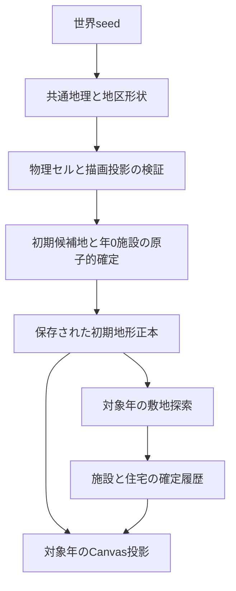

# Issue #31 — 世界生成・地形多様化 詳細設計案（D0）

状態：**Humanレビュー待ち／設計のみ／実装許可・スキーマ確定ではない**。調査日：2026-11-06。
目的は、新規ゲームごとに地形と土地に沿う街並みが異なり、長い時間を観察したくなること。
320×180px固定カメラ、川辺・丘陵・入り江の3地点、同一文明の年月・歴史を維持する。

本書の「事実」は下記固定リビジョンのコードに限定する。「提案」「暫定値」は未承認仕様であり、重大判断は§12で承認してから実装する。過去の意図をコードから推測して確定しない。

## 1. 調査基準と現状

- main：[`d2f7cb178eeb6981ff5b62f2fbf5d2819f8130ac`](https://github.com/k-hsmt/namonaki-bunmei/tree/d2f7cb178eeb6981ff5b62f2fbf5d2819f8130ac)。以下のmain参照はこの版に固定する。
- [Draft PR #46](https://github.com/k-hsmt/namonaki-bunmei/pull/46)：HEAD [`7514d7384af1521d908bf1785ecb8d6bfe3f912f`](https://github.com/k-hsmt/namonaki-bunmei/tree/7514d7384af1521d908bf1785ecb8d6bfe3f912f)。調査時open・Draft・未マージ。mainに `src/terrain/river-prototype.ts` は存在しない。
- [#31](https://github.com/k-hsmt/namonaki-bunmei/issues/31)、[#47](https://github.com/k-hsmt/namonaki-bunmei/issues/47)、[#32](https://github.com/k-hsmt/namonaki-bunmei/issues/32)、[#34](https://github.com/k-hsmt/namonaki-bunmei/issues/34)、[#35](https://github.com/k-hsmt/namonaki-bunmei/issues/35)の本文・コメントを確認（コメントはいずれも0件）。Issue本文は将来更新され得るため、調査時点の構想として扱う。
- リポジトリツリーにAGENTS.mdなし。今回の依頼を作業制約の正本とする。

### 1.1 mainで確認した事実

| コード／資料 | 実装済み・制約 | #31で必要になる接続（提案） |
| --- | --- | --- |
| [draw.ts](../src/scene/draw.ts) `drawScene` | 遠山・中景丘陵は全地点共通の固定ポリゴン。地点1の丘陵、地点2の海岸線、地点0の川も固定。seedは草等の配置を変える。水面の洪水演出は別ポリゴン。橋は存在・状態を調べ、座標固定で描画 | 保存済み輪郭・水面・橋の確定形状から描く。旧描画は別経路として保持 |
| [housing-ground.ts](../src/scene/housing-ground.ts) | 川辺の固定河川ポリゴンを描画とは別定数で保有。敷地はピクセル中心で検査。通常建物18×7、畑26×14、橋56×7、civicは保存footprint。屋根・樹冠と土地を区別。丘陵・入り江の斜面／水域の統一判定はない | 3地点の地形判定を純粋なterrainモジュールへ移し、互換用旧関数を残す |
| [settlement-history.ts](../src/story/settlement-history.ts) | 11の固定候補を3地点で共有。初期の居住地点に候補0のhouse。IDは地点ID＋候補番号。後年の必要人口・交易・余力・間隔で選ぶ。橋候補は川辺限定。`canBuild` は許否のみで座標を返せない。固定予約地は将来候補であり建設履歴ではない | 論理的な施設枠と座標選択を分ける。適応配置の返値を受けるAPIが必要 |
| [housing-progression.ts](../src/story/housing-progression.ts) | 川辺のみ。60年ごと・人口900以上、18×8の格子候補を走査。既存施設・住宅・共同空地を避ける。丘陵・入り江はunsupported-terrain | 地形・通行・敷地を共通ゲートで探索し、3地点に順次開放 |
| [civic-progression.ts](../src/story/civic-progression.ts) | 川辺のみ。40年ごとの試行、寄り合いの24年継続・既存hall・余力等が条件。44×22／56×30。両岸の候補をhall・住宅との距離で評価し、固定施設予約地を避ける | 社会的条件は維持し、候補探索と通行距離だけ差し替える。地点制約・ID検証・呼出元も同時対応が必要 |
| [public-space-progression.ts](../src/story/public-space-progression.ts) | 川辺のみ。hall南側／側面の24×10、2px通り口、住宅との関係を検査。履歴上の成立・過繁茂・再利用を記録 | 共通土地判定へ接続。新しい空地種別・滞在演出の追加はしない |
| [engine.ts](../src/story/engine.ts) | 年次確定で通常施設→civic→住宅建設→住宅状態更新→共同空地の順に接続。`canBuild` は住宅・civic・空地との占有を検査するが新地形の水面・斜面を検査しない | 同年の順序を維持し、各確定直前に最新占有で再検査する |
| [housing-history.ts](../src/story/housing-history.ts)、[civic-architecture.ts](../src/story/civic-architecture.ts)、[public-space-history.ts](../src/story/public-space-history.ts) | 年・出典・敷地の確定履歴。住宅のknown／partial／unknown、大型建築・空地の不変属性検証。civic・空地のID／地点検証には川辺限定がある | 型だけを広げず、保存検証・履歴再生・自然進行・描画を一括して地点対応 |
| [housing-save.ts](../src/story/housing-save.ts)、[housing-persistence.ts](../src/story/housing-persistence.ts) | 外側version=4、住宅schemaVersion=1。v2/v3を前方移行、未記録住宅を復元しない。v4住宅欠損は拒否。現在キー `namonaki-story-v4`、旧v3/v2キー。現行値破損時の暗黙フォールバックなし | 旧形状を保つ経路と新規地形保存を明示的に区別 |
| [observations.ts](../src/story/observations.ts)、[scene/model.ts](../src/scene/model.ts)、[composition.ts](../src/scene/composition.ts) | 確定年の人口・施設・住宅を読む。100年チェックポイントと年差分。未記録の旧境界を保持。過去観測は再シミュレーションしない | 同じ初期地形正本と対象年の占有を投影し、最新年の建物を過去へ混入させない |
| [main.ts](../src/main.ts) | 新規作成は `createHousingCivilization`。読込は候補検証後に状態差替え。保存は検証後setItem。描画へ地形は渡していない | 新規作成の原子化、地形つきsnapshot、失敗時の現状維持 |

関連文書： [H2保存設計](v0.6-h2-housing-save-migration-design.md)、[H3土地ゲート](v0.6-h3a-land-use-gate.md)、[H3長期監査](v0.6-h3c-longrun-audit.md)、[D5立地](v0.6-h4d5-civic-siting.md)、[D7履歴](v0.6-h4d7a-public-space-ledger.md)、[D7自然成立](v0.6-h4d7b-natural-public-space.md)。これらは各作成時点の設計・記録で、現在の実装状態は上表のコードを優先する。

### 1.2 PR #46だけにあるもの

[生成器](https://github.com/k-hsmt/namonaki-bunmei/blob/7514d7384af1521d908bf1785ecb8d6bfe3f912f/src/terrain/river-prototype.ts) は `river-prototype-v2`、10系統。6断面の中心・幅を補間し、複数河道と中州ポリゴンを生成。通常のseed選択で各系統の代表を探す。水面の和集合から中州を除く同じ判定を描画と土地検査に使う。

`reviewPrototypePlot` は画面内・y≥95・水没のみを検査する。「land」は斜面・通路・他敷地を含む建設許可ではない。旧形状参照は10種類に含めない。`draw-river-prototype.ts` の背景山並みは固定で、山・丘陵・海岸生成はない。本編・保存・実建設へ未接続。

PRの[試作資料](https://github.com/k-hsmt/namonaki-bunmei/blob/7514d7384af1521d908bf1785ecb8d6bfe3f912f/docs/issue31-river-terrain-prototype.md)では、広い曲流・S字・斜め・中州・網状流・合流・分流で通常の固定候補が1〜3区画水没。橋は全ケース別設計HOLD。固定候補をそのまま新地形へ適用できない証拠である。

PR報告および既確認CI：Node110件、既存ブラウザ24件、地形11ケースの水面描画／マスク一致とPNG再現性、長期進行が成功。ただしこれは山・他地区・本編接続の受け入れ結果ではない。

### 1.3 未確認・現状では保証しない点

- 3画面間の実距離・方角・標高の従来合意は見つからない。連続した巨大地図や実在流域の水理は実装されていない。
- 山の種類数や保存形式v5の採用は未決定。§12の推奨であり以前の決定ではない。
- 地形による建設HOLDは施設の成立・規模分類を変え得る。既存の人口計算が同じだから全歴史も同一、とは保証できない（§7.8）。

## 2. スコープ案と責務境界

今回の依頼で指定された範囲を#31のスコープ案として整理する。実装開始は本書のHumanレビュー後。

| 対象 | #31で作るもの | 対象外／引渡先 |
| --- | --- | --- |
| 初期世界 | 320×180×3地点、流域・起伏・海側の共通地理、地形形状と保存 | 巨大移動マップ、実際の侵食・流体計算 |
| 川・丘陵・海岸・遠山 | 輪郭・水域・平地・斜面・岩盤、遠近の投影 | #47の砂漠・草原・熱帯雨林・ツンドラ等の初期気候帯 |
| 土地利用 | 既存種類の家・畑・hall・工房・市場・穀物庫・橋、住宅街区・civic・共同空地の適応配置 | #35の新しい建物種・建材・建築様式。城・館・政庁は引き続き保留 |
| 植生 | 既存の草・樹木を地表と整合して置く静的描画の接続 | #47が初期バイオーム分布、#32がその後の成長・森林化・自然遷移 |
| 時間変化 | 初期地形不変、確定した建築史との合成 | #34が長期気候・洪水による恒久変形・開墾・切土・河道改変。季節・動物・生活アニメーションも対象外 |

#31は気温・降水量や資源の生産性を仮決定しない。#47に地理の読み取り口を渡す。#32は保存された初期環境とその後の植生履歴を所有する。#34の将来改変は初期正本を書き換えず、確定年を持つ差分として別設計する。#35は#31の合法候補選択APIを使い、新様式の実占有サイズ・入口・描画外接矩形を申告する。

## 3. 地形カタログ案

川10は必須。丘陵8・海岸8・遠山6は目標で、合計32の読み分け可能な形態を提案する。色違い・数px移動・左右反転だけを別系統に数えない。各系統内のseed差は別に作る。以下の制約は生成と受入の両方で検査する。

遠山は背景のみで、見えている山の斜面をそのまま建設禁止域にしない。中景・近景の丘陵は物理地表を持つ。この区別は全表に適用する。

### 3.1 川 R01〜R10（PR #46を尊重）

| ID／名称（既存variant） | 形状・原寸での違い | 建設可能地への影響 | 生成制約 | 組合せ条件 |
| --- | --- | --- | --- | --- |
| R01 直線的な流れ `straight-channel` | ほぼ一定方向の一本、水面は手前ほど広い | 両岸に連続する帯状平地、狭部に橋候補 | 岸の逆転・途切れなし | 開けた谷・段丘と好相性 |
| R02 細い蛇行 `narrow-meander` | 細い流路が小さく屈曲、陸地の割合が大きい | 小街区を多く取れるが岸際の張出しを避ける | 原寸で水路幅6px以上 | 起伏の弱い丘陵・河口部以外の上流側 |
| R03 幅広い曲流 `broad-bend` | 一方向の大きな湾曲と広い水面 | 内側岸にまとまり、外側岸は狭い。橋はHOLDになり得る | 狭い側も最低初期敷地を確保 | 広い谷底、海岸の大きな湾と整合 |
| R04 大きなS字 `wide-meander` | 屈曲方向が途中で反転する明瞭なS | 集落核が複数の陸の張出しに分かれる | 曲流接近部の陸が1pxで潰れない | 緩やかな丘陵、狭い峡谷と組ませない |
| R05 斜めの流れ `diagonal-crossing` | 奥右→手前左を横切り画面を二分 | 建設域は対角の二群、橋の接続価値が高い | 画面端で河道を突然切らず水域ポートを定義 | 斜行する谷筋と海側方位を共有 |
| R06 大きな中州 `island-channels` | 一つの大きい陸地を水路が包む | 島は陸地だが橋なしで初期核・公共建築を置かない | 島全周が河道内、水路連続幅6px以上 | 幅広い低地、河口デルタとは区別 |
| R07 二つの中州 `twin-islands` | 独立した二島を縦に読む | 小さい孤立地が増え、広い敷地は岸側へ | 島同士を接触させず、全周を検査 | 低地・広い流域に限定 |
| R08 網状流 `braided-channels` | 中ほどに3河道、分離と再接続 | 陸は断片化、一本橋で全域がつながるとみなさない | 分岐点が連続、各河道可視幅を保つ | 広い谷底。急峡谷との組合せ禁止 |
| R09 合流 `confluence` | 奥側2入口が手前1出口になるY字 | 二河川の間と両側に核候補、合流点上は避ける | 流域グラフに2本の上流支流を保存 | 丘陵に支谷を持たせ、海へは1主流として接続 |
| R10 分流 `distributary` | 奥側1入口から手前2出口へ分かれる | 分流間の陸は接続検査、橋は一河道ずつ | 下流2出口の行先を保存 | 下流低地向け。入り江側で同一湾へ注ぐ2河口を許す |

PR #46の代表seedは順に6,1,3,8,24,10,2,21,9,5。v2の形状を比較用基準として保存する。本番生成器が世界の適合条件で選択を変える場合、旧試作seedの選択一致は本番仕様にしないが、10系統を削減・黙って改名しない。

### 3.2 丘陵 H01〜H08（提案）

| ID／名称 | 形状・原寸での違い | 建設可能地への影響 | 生成制約 | 組合せ条件 |
| --- | --- | --- | --- | --- |
| H01 片側の長い丘 | 画面の片側が盛り上がり反対側に広い平地 | 裾に帯状の家並み、上部は斜面 | 丘の面積25〜45%、裾の連続平地を残す | 直線川・細い川と相性。海側に低下 |
| H02 二つの丸い丘 | 二峰とその間の低い鞍部 | 二つの裾と鞍部に接続、civicは谷側 | 峰の間隔60px以上、鞍部に幅8px以上の通行域 | 支谷・合流と整合可 |
| H03 広い谷底 | 左右の丘が谷を囲み中央が開く | 谷沿いに線状の街、谷底に大敷地 | 平坦部幅80px以上、斜面を背面として描く | 大曲流・網状流も可 |
| H04 緩い台地 | まとまった高い平面と輪郭の段差 | 台地上と裾の2層、昇降可能地点に入口を寄せる | 台地上60×35px以上、最低1本の緩い連絡路 | 河岸段丘・湾奥の台地と整合 |
| H05 連なる低丘 | 3〜4個の低い起伏が横に続く | 平地が小群に分散、家並みも分かれる | 高低差を小さく、1pxの斜面ノイズ禁止 | 蛇行川・小湾と相性 |
| H06 斜めの尾根 | 奥の片側から手前の反対側へ連なる稜線 | 尾根の両側で街区方向が変わる | 横断できる鞍部1か所以上、崖で画面を完全分断しない | R05と谷の軸を共有、川と尾根は別領域 |
| H07 河岸段丘 | 高低2段の平地を斜面帯が分ける自然段丘 | 低段と高段に別の建設帯 | 斜面帯3px以上、人工の段々畑として描かない | 主流の標高・流下方向と整合 |
| H08 岩のある狭い谷 | 尖った岩の斜面と細長い低地 | 大型建築がHOLDになりやすく、小さな核が並ぶ | 初期家屋と2px通行域を必ず確保。岩壁は非建設地 | 細い川向け。網状流・大中州との組合せ禁止 |

### 3.3 入り江・海岸 C01〜C08（提案）

| ID／名称 | 形状・原寸での違い | 建設可能地への影響 | 生成制約 | 組合せ条件 |
| --- | --- | --- | --- | --- |
| C01 広く浅い湾 | 横長の緩い弧で海と陸を分ける | 海岸沿いに広い連続敷地 | 海は画面外の外海ポートへ連結 | 広い低地・どの主流でも可 |
| C02 深く入り込む湾 | 海が中央へU字状に食い込む | 湾の両側と湾奥に集落群 | 両岸に初期敷地、湾奥は尖りすぎない | 谷底H03・尾根H06と対応 |
| C03 狭い湾口と広い湾奥 | 入口が絞られ内側に水面が広がる | 内岸の平地と出入口付近に核 | 湾口水路6px以上、閉じた湖にしない | 台地／二丘が入口を挟む |
| C04 岬に守られた片湾 | 一方の岬が海へ張り出す非対称の輪郭 | 岬根元と湾内に敷地、岬端は岩・斜面 | 岬の付け根8px以上、水面が外海につながる | H01と岬側を共有 |
| C05 二つの小湾 | 半島状の陸を挟み湾が二つ並ぶ | 2核と連絡路、片湾だけの発展も可能 | 湾間の陸幅12px以上、両湾の外海接続 | 二丘・連丘と整合 |
| C06 河口の湾 | 主流の淡水域が海水域へ連続する明瞭な河口 | 河口両岸と湾奥に敷地、河口上の建設禁止 | 世界の主流IDと接続、淡水／海水境界を保存 | R01〜R09は主出口1、R10は同湾に2河口 |
| C07 砂州のある入り江 | 細長い陸の帯が内湾を部分的に囲む | 砂州自体は不安定地盤で建設不可、内陸岸を使う | 海との開口6px以上。砂州は季節移動しない初期形状 | 低地・緩い海岸向け。岩峡谷と併用不可 |
| C08 岩岸と小さな浜 | 折れた岩岸の間に小さい平地がある | 点在する浜・背後平地、civicはHOLD可 | 初期家屋の平地を1か所以上、海へ崖を描く | H08・H01と相性、広い網状河口は不可 |

C07の砂州は地形・地盤分類であり、#47の砂漠バイオームではない。砂州・岩岸は既存地表色の範囲で描き、海洋生態・潮汐は導入しない。

### 3.4 遠景の山並み M01〜M06（提案）

| ID／名称 | 形状・原寸での違い | 建設可能地への影響 | 生成制約 | 組合せ条件 |
| --- | --- | --- | --- | --- |
| M01 一つの高い峰 | 主峰一つが明瞭、左右に低い裾 | 直接の占有なし | 主峰と周辺に高さ差16px以上 | H01・台地の背景 |
| M02 二峰と鞍部 | 二つの大きい峰の間が深く下がる | 直接の占有なし | 峰間60px以上、鞍部深さ12px以上 | 二丘・支谷と方向を共有 |
| M03 長い低山脈 | 高い主峰がなく低い稜線が長く続く | 直接の占有なし | 輪郭の上下差8〜18px、微細ギザギザ禁止 | 連丘・広い低地 |
| M04 峡谷の開口 | 両側が高く中央が大きく開く | 近景谷と方向を共有するだけ | 開口幅70px以上、開口下に建物を隠す壁を置かない | H03・H08、合流の出口方向 |
| M05 奥行きのある重山 | 遠近2〜3列の峰がずれて重なる | 直接の占有なし | 明度差と輪郭を分離、地表の建物より低コントラスト | 起伏の強い流域。海側は列を低くする |
| M06 片側が海へ開く山並み | 片側に山、反対側は低い水平線へ抜ける | 直接の占有なし | 海側の空き幅90px以上 | 世界の海側方位を3地区で共有、入り江に適合 |

山を全画面で単純に同じ輪郭コピーにせず、同じ世界の主峰・鞍部のIDを視点別に投影する。遠景山が全くない系統は追加候補だが、6系統に水増しして含めない。

## 4. 同一世界の地理と生成手順（推奨案）

### 4.1 地理的一貫性

推奨は**抽象流域グラフ＋3地区の投影**。連続した巨大地図・標高シミュレーションは作らない。共通情報は海側（east/west）、上流→下流の順、主流・支流ID、地形の強さ（low/medium/high）、山のランドマーク。丘陵は川辺の上流側・側方、入り江は下流側の地区とするが、居住・生産・交易の役割は固定しない。

3画面は離れた観測窓で、同じピクセル座標が隣の画面へ連続する仕様ではない。接続はポートのstreamId・flow・relativeElevationで検査する。合流の支流は川辺に入る前に分かれ、分流の2出口は同じ外海へ流れる。入り江がC06以外なら河口を観測窓外の接続として記録し、画面に無理に河川を追加しない。

海側east/westは抽象方位で、全画面の手前を海とする意味ではない。地区ごとの投影で画面上の出入口を決めて保存する。主流の上下流ポートは逆流させず、標高は下流で増加しない。これは地理的な整合性検査で、水理的正確性の保証ではない。

### 4.2 決定的な生成順

1. 既存と同じseed正規化 `n=(input>>>0)||1`。試作単体のseed=0とゲームseedの扱いを混同しない。
2. 文明の可変RNGから独立した名前空間hashで、世界地理→適合する地形系統→地区内形状の順に生成する。
3. 適合表で禁止組合せを除外。形状候補を作り、水路連結・島・陸・斜面・視認性・ポートを検査する。
4. 初期敷地の存在を検査する（§7）。失敗した候補は捨て、`attempt=0..31` の順に同じ系統内で再生成する。無限再抽選しない。
5. 32回失敗時は `generation-failed`。別系統へ黙って落とさず、現在のゲーム・保存を保持する。完成前に受入seed群で失敗0を目指す。失敗率・系統偏りを監査に出す。
6. 成功した3地区、初期敷地・アクセス核、描画情報を一つの候補として検証・凍結し、年0施設履歴とともに原子的に確定する。

hashはUTF-8の長さ付き要素列（generatorId,worldSeed,namespace,siteId,variantId,attempt,objectKey）をFNV-1a 32bitで畳み込み、最後に整数mixする案。返値を `u/2**32` にして上端1を避ける。名前空間を `geography` / `river` / `hills` / `coast` / `mountains` / `placement` / `decoration` に分離し、golden vectorで固定する。暗号用途ではない。`Math.random`、Canvas、日時・配列挿入順・文明rngStateは入力にしない。

## 5. データモデル案

### 5.1 正本の選択

| 方式 | 長所 | 問題 | 推奨 |
| --- | --- | --- | --- |
| seedのみ保存し最新生成器で再生成 | 小さい | 更新で旧世界が変わる | 不採用 |
| seed＋生成器版、旧生成器を永久保持 | 保存量は小さい | 全旧アルゴリズムと実行環境の維持が必要 | 旧セーブ描画の互換用途だけ |
| **形状・物理地表・描画投影の生成結果を保存** | 生成器変更から世界を切り離せる | 保存量・整合検査が増える | **新規世界に推奨** |

物理地表は320×180のセル（画面地表座標）で定義する。背景山の見かけの傾きから斜面を計算しない。各セルに地形生成時の局所標高・斜面クラス・地盤・水種を与える。単位はゲーム内相対値で、メートルや実勾配を装わない。形状は輪郭と由来の正本、物理セルは土地判定の正本、描画はその物理セルと保存された投影を参照する。両者を独立にランダム生成しない。

セルは行単位RLEで保存し、スキーマ固定のデコーダで復元する。水面と海岸の可視色塗りは同じセルを使う。輪郭とセルの整合は固定版rasterRuleで検証し、不一致を描画時に修正しない。将来の新rasterizerで旧セルを再生成しない。

### 5.2 TypeScript型草案（このPRではコンパイル対象に追加しない）

```ts
type SiteId = 'river-bank' | 'hill-side' | 'coast-inlet';
type Point = readonly [number, number]; // 画面地表座標
type WorldPoint = readonly [number, number]; // 世界内相対座標0..1024
type Polygon = readonly Point[];
type Plot = Readonly<{x:number; y:number; width:number; depth:number}>;
type Grade = 0 | 1 | 2; // 0平坦、1緩斜面、2急斜面。画面のdy/dxではない
// 固定の数値コード。順序を後から変えない
// surface: 0非地表,1陸,2淡水,3海水 / bearing: 0安定,1砂州,2岩壁
interface Cell { surface:0|1|2|3; grade:Grade; bearing:0|1|2; elevation:number }
interface CellRun { length:number; value:Cell }
interface PhysicsRaster {
  encoding:'row-rle-v1'; width:320; height:180;
  rows:readonly (readonly CellRun[])[]; // 各行length合計320、行数180
}
interface WaterPort {
  id:string; streamId:string; flow:'in'|'out';
  screenPoint:Point; relativeElevation:number;
}
interface Geography {
  seaSide:'east'|'west'; relief:'low'|'medium'|'high';
  streams:readonly {id:string; from:string; to:string}[];
  landmarks:readonly {id:string; position:WorldPoint; height:number}[];
  districts:Record<SiteId,{upstreamOf:readonly SiteId[]; cameraSide:'east'|'west'}>;
}
interface GroundShape {
  id:string; kind:'land'|'freshwater'|'sea'|'island'|'slope'|'cliff'|'sandbar';
  polygon:Polygon; grade:Grade; elevation:number;
}
interface Silhouette {
  landmarkIds:readonly string[]; contour:readonly Point[];
  tone:'far'|'middle'; // 現行パレットの役割。気候帯ではない
}
interface SiteTerrain {
  siteId:SiteId;
  variants:{river:string|null; hills:string|null; coast:string|null; mountains:string};
  shapes:readonly GroundShape[];
  waterPorts:readonly WaterPort[];
  physics:PhysicsRaster;
  render:{
    far:readonly Silhouette[]; middle:readonly Silhouette[];
    foreground:readonly Polygon[]; // 画面手前の地表縁。占有はphysicsで判定
    decorationSeed:number; horizonY:number;
  };
  initialPlan:{
    nucleus:Point; accessRoots:readonly Point[];
    facilitySites:readonly {slot:number; plot:Plot|null; reason:string|null}[];
  }; // 未建設候補。建設年・建設史ではない
}
interface GeneratedTerrain {
  schemaVersion:1; mode:'generated'; establishedYear:0;
  generatorId:'world-terrain-v1'; rasterRule:'pixel-center-v1';
  rendererId:'terrain-render-v1'; placementPolicy:'terrain-placement-v1';
  worldSeed:number; geography:Geography;
  sites:Record<SiteId,SiteTerrain>;
}
interface LegacyTerrain {
  schemaVersion:1; mode:'legacy-fixed';
  rendererId:'legacy-d2f7cb1'; groundRule:'legacy-ground-d2f7cb1';
  // 初期地理・過去の形状・気候は記録されていない。推測して追加しない
}
type InitialTerrain = GeneratedTerrain | LegacyTerrain;
interface EnvironmentGeometryPort {
  terrainSchema:1; siteId:SiteId;
  sample:(x:number,y:number)=>Readonly<Cell>|null;
  waterPorts:readonly WaterPort[];
  // #47が気候・初期植生を別の保存正本として付与。ここではnull/未導入
  initialEnvironmentRef:null | {schemaVersion:number; id:string};
}
interface PlacementRequest {
  purpose:'house'|'field'|'hall'|'workshop'|'market'|'granary'|'housing'|'civic'|'public-space';
  objectId:string; siteId:SiteId; year:number;
  width:number; depth:number; entrySide:'south';
}
interface GroundContext {
  terrain:GeneratedTerrain; year:number; siteId:SiteId;
  occupancy:readonly {id:string; plot:Plot; kind:string}[];
  // この年以前に確定した橋のうち通行可能な接続だけ
  crossings:readonly BridgePlacement[];
  historyStatus:'known'|'partial'|'unknown';
}
type ProposedResult<T> = {status:'ok';value:T} | {status:'hold';reason:string};
type HoldReason = 'unknown-history'|'outside-ground'|'water'|'steep'|'unstable'
  |'occupied'|'no-access'|'no-safe-plot'|'unsupported-bridge'|'unconfirmed-year';
type PlacementResult =
  | {status:'clear'; plot:Plot; entrance:Point; access:readonly Point[]; score:number}
  | {status:'hold'; reason:HoldReason; conflicts:readonly string[]};
interface BridgePlacement {
  bridgeId:string; siteId:'river-bank'; builtYear:number;
  bankSupports:readonly [Plot,Plot]; deck:Plot;
  bankA:Point; bankB:Point; streamId:string; axis:'horizontal';
  sourceRecordId:string; // 本設計初版は単径間、横向き。§7.6
}
```

型中のnumberは保存検証で全て有限安全整数・値域を強制する（輪郭座標0..320/0..180、相対標高0..255、horizonY 48..90）。ポリゴンは3頂点以上・自己交差なし・面積正、隣接重複頂点なし。画面枠の320/180は輪郭境界のみ許可、セルは0..319/0..179。水面はgrade=0、非地表は建設不可。variantsのstringは実装時に上記IDのunion＋地形スキーマごとの検証表に置換する。

### 5.3 主な関数・流れ

```ts
// 純粋。失敗時に既存世界を返り値で置き換えない
// ProposedResult<T> = {status:'ok';value:T} | {status:'hold';reason:string}
declare function generateInitialTerrain(seed:number):ProposedResult<GeneratedTerrain>;
declare function validateInitialTerrain(raw:unknown):InitialTerrain;
declare function sampleGround(t:GeneratedTerrain,site:SiteId,x:number,y:number):Cell|null;
declare function occupancyAt(state:unknown,site:SiteId,year:number):GroundContext;
declare function reviewGround(ctx:GroundContext,request:PlacementRequest,plot:Plot):PlacementResult;
declare function findPlacement(ctx:GroundContext,request:PlacementRequest):PlacementResult;
declare function terrainAt(t:InitialTerrain,year:number):InitialTerrain;
declare function projectTerrain(t:GeneratedTerrain,site:SiteId):SiteTerrain['render'];
```

`ProposedResult`の実装時は既存の結果型と統一してよいが、HOLDを空の成功値に変えない。型のunknownは既存状態型をこの文書内で重複定義しないための省略で、実装APIでは具体型を使う。



後続環境APIは読み取り専用。#47は初期条件を別保存し、#32/#34は対象年付き履歴を重ねる。未導入の環境参照はnullであり、温帯・湿潤などの推定値に置き換えない。

## 6. 物理地表の統一仕様（提案）

- 敷地は左上・幅・奥行の半開矩形 `[x,x+w)×[y,y+d)`。整数セル中心 `(x+.5,y+.5)` を全て検査する。四隅のみの検査は禁止。接辺は衝突でない。
- 地表のsurface=1かつbearing=0のみ通常建設可。砂州・岩壁・背景・水面・画面外は不可。
- 住宅・家屋・工房・穀物庫はgrade≤1、敷地内標高差≤2。畑もgrade≤1・差≤2。hall・市場・civic・共同空地は全セルgrade=0・差≤1。暫定値は§12のまとめでレビューする。
- 斜面等の物理ラベルは形状生成時に決める。遠山・中景背景はsurface=0として背後に描き、建物が立つ地表と混同しない。丘の上の平坦面はsurface=1・grade=0。
- 占有は施設、住宅街区、civic、共同空地、橋の橋台。廃墟・空き家・草の増えた空地も占有を維持する。撤去・解放は別の確定イベントが必要。
- 水上の橋桁は特殊用途のみ。通常施設の検査に「橋だから水面可」という例外を渡さない。
- 屋根・庇・樹冠の外接矩形を地表判定に使わない。表示の重なりは別の視認性レビューで扱う。
- 初期施設、後年施設、住宅、公共建築、空地は同じ `reviewGround` を通す。描画や保存読込から新規建設を行わない。

## 7. 地形に適応する建設仕様案

### 7.1 初期施設と将来候補

既存11候補は「用途・必要条件・論理ID」を維持し、座標定数だけを新規世界で置換する。ID `siteId-slot` はその枠が一度建ったら不変。初期候補0は居住地点で年0に家屋として確定し、`builtYear=0`。初期人口の地区配分は変えない。

候補生成は地表上の2px格子（x=2,4,…、y=96,98,…、敷地が枠内に収まるまで）。地形に応じたスコアと合法判定で順位付けする。候補地は履歴ではない。初期核・accessRootsと、通常施設枠の予備敷地を保存する。橋以外の予備敷地は相互非重複とし、初期核から通行できる連続陸に優先する。

推奨は「初期家屋必須＋初期畑を置ける予備地必須、残りはHOLDを許可」。全11施設・civicが必ず入るまで地形を平らにする仕様にしない。予備地未確保はnullと理由を保存し、当該用途が必要になった年に再探索する。未建設の予備地を建物として描かない。

通常施設用の非null予備地はcivic・住宅・空地から保護する。将来枠に無制限の面積を予約せず、通常10枠までとする。未建設橋は物理占有しない。候補予約と実占有はAPI上も別配列にする。Humanが予約方式を採用しない場合は§12の代替へ切替える。

### 7.2 アクセス・自然な核形成

通行可能セルは安定陸地grade≤1。敷地占有は障害物。入口は敷地南辺中央の外側セル。入口の左右1セルを含む2px幅の通路が、初期accessRootまたは既存の有効な入口群へ接続することを要求する。

経路探索は2px幅が通るセルマスク上で4近傍BFS（順序N,E,S,W、同距離はy,x順で固定）。入口から既存ネットワークへの最短路長をスコアに使う。川越えは確定済みでintactな橋のdeckのみ許可し、島や対岸を距離だけで近いと判定しない。初期核は保存されたaccessRootから到達可能とする。最初の家を建てるために未来の家の入口を要求しない。

これは実際の道路建設履歴や交通量ではなく、土地利用の到達可能性である。通路を石畳・道路の史実として保存・描画しない。家を追加する際には既存の全ての入口への経路を再検査し、後発建築が唯一の通り口を塞ぐ場合はHOLD。廃墟の橋は占有を維持するが通行辺を失う。アクセス喪失だけで既存家屋を移設・削除しない。

### 7.3 用途別の候補順位（暫定値、整数スコアで小さいほど優先）

ハード条件通過後、`S=4×Dcore + 3×Dneighbor + Pwater + Pslope + Pdepth + T` を基本とする。距離は上記最短通路長（px換算）、未接続は候補から除く。Tは独立hashで0..3、同点はy,x,objectIdの順。微小なseed差で不合法位置が選ばれることはない。

| 用途 | サイズ／条件 | Dcore・Dneighborと補正 |
| --- | --- | --- |
| 初期家屋・通常house | 18×7、既存用途を維持 | 初期核または最寄り既存住宅へ寄せる。初期核は陸の連続成分内で水際から8〜32pxの候補を優先 |
| 畑 | 26×14、安定地盤・緩斜面まで | 家屋から12〜64pxを優先。水際8〜40pxならPwater=0、遠過ぎる分に2/px。海水近傍を灌漑と見なさない |
| 工房・穀物庫 | 18×7 | 住宅・畑との通行距離を優先。水面ぎりぎりは安全余白で減点 |
| hall・市場 | 18×7 | 住宅群と既存の核に接続。市場の交易条件は現行維持。川があるだけで交易施設を建てない |
| 住宅街区 | 18×8、既存3様式を維持 | 既存住宅へのDneighborを強めて6倍にする。地形の平坦帯・裾に沿って群を作り、同じ行へ機械的に詰めない |
| 大型公共建築 | 44×22／56×30、現行様式のみ | 既存hallと住宅群の入口への距離を用いる。寄り合い・余力・年条件は維持。既存hallを拡大・置換しない |
| 共同空地 | 24×10、現行assembly-groundのみ | hallの南・側面かつ入口に通行接続、住宅から通路長80px以内。既存の成立・過繁茂・再利用条件を維持 |

普通建物のanchorは `(x+floor(w/2), y+d-3)`、畑は `(x+13,y+8)` とする。いずれも現行 `existingGround` の矩形と一致させる。civicのanchorは現行同様 `x+floor(w/2), y+d-5`。実装では用途別の変換を一箇所に定義し、保存footprintと逆算値が一致するテストを持つ。

Pwaterは普通建物で水域まで2px未満ならHOLD、2〜7pxは `(8-distance)×4`、8px以上は0。水域のない丘陵では0。Pslopeはgrade1セル数。Pdepthはy>150の超過1pxにつき2。Dcoreは初期核への経路長、Dneighborは用途に関連する最寄り確定施設への経路長。対象施設がまだ無い場合Dneighbor=0で、存在を捏造しない。後年の成立条件がhall必須等の場合は別の社会ゲートでHOLDする。

丘陵では台地・谷底・裾の平坦な接続成分を候補にし、海岸では湾奥と浜の背後を優先する。斜面の見かけを理由にスプライトだけ上げ下げしない。3地点に同じ格子の建物列を複製せず、地形マスクと経路距離が配置を変える。

### 7.4 確定手順・HOLD

1. 既存の社会的必要条件を判定。対象年が未確定なら候補確定しない。
2. 対象年の確定履歴から占有を読み、予備地→全候補の順に検索する（予備地も必ず再検査）。
3. 境界→地表→地盤／斜面→実占有／他用途予約→通行→社会条件の順に検査。最初の失敗分類と全衝突IDを返す。
4. 最良候補を、同年の先行建設を含む最新占有で再検査。施設・敷地・記録IDを一つのトランザクションで追記する。
5. HOLDなら施設・建設年・履歴イベント・lastWork・文明RNGを変更しない。次の現行試行タイミングで再試行。診断は履歴に大量追記しない。

HOLD分類：unknown-history、unconfirmed-year、outside-ground、water、steep、unstable、occupied、no-access、no-safe-plot、unsupported-bridge。社会条件によるnot-ready／no-capacity等は現行と別に保持する。不合法敷地を「見栄え」で許可しない。

通常施設は現行と同じ「最初の未建設で必要条件を満たす枠」を選ぶ。該当枠がHOLDならその年に後続枠へ飛ばさない。恒久HOLDで進行が止まる可能性は長期監査に出し、黙ってルールを変えずHuman判断とする。

### 7.5 ID・履歴の不変性

建設時にID、siteId、用途、敷地、入口、建設年、様式・styleSeed、出典記録IDを固定する。住宅IDは地点別の確定建設連番、HOLDで連番を消費しない。civic／空地は地点IDを含む既存形式を拡張し、旧川辺IDを変えない。序数は配列の現在件数だけに頼らず確定履歴から求める。

修繕・廃墟化・再利用・規模分類変更は場所を変えない。候補スコアや生成器の更新で確定位置を再評価して動かさない。年0以外の未建設候補に建設年を与えない。過去年への新築は禁止。保存検証は全遷移を検査し、描画では対象年以前のものだけ読む。

### 7.6 橋（初版の推奨：横向き単径間）

現行の固定横橋を可変長にし、川辺のみを対象とする。水平に走査した一本の河道を渡す。新しい様式・吊橋・斜橋・複数径間・海上橋は今回導入しない。川の10系統全てで必ず橋が建つとはしない。

- y=108..170を2px刻みで走査。左右に安定陸地・grade0、4×6px以上の橋台、南北2pxのアクセス口を確保する。
- 水面区間の幅6..56px、左右の陸地への掛かり4pxずつ、deck奥行4px。全deckは画面内、支点の標高差≤1。長さは実際の水面幅＋8px。
- deck下の水域は一つのstreamIdの連続区間。中州や複数河道を一括で跨ぐ候補はHOLD。合流・分流点の上下8px、海水域、急斜面、他敷地との衝突もHOLD。
- 左右橋台の各入口は、それぞれの陸のaccessRoot／確定入口に接続する。橋自身の通行辺を使って橋台へ到達した扱いにしない。既存家がない対岸には保存された自然のaccessRootを使える。
- 需要人口・8年間隔・必要余力など既存の橋成立条件を変更しない。候補は陸の接続改善量→核への通路長→短い径間→独立hash→y,xで順位付け。
- `BridgePlacement`を建設履歴へ同時保存。描画はdeck・橋台・支点から行い、現在の固定(120,141)等を生成世界では参照しない。損傷・廃墟は同じ支点に残す。
- 水域に重なるdeckは合法だが橋台は陸、他用途は水面不可。橋の実占有と通行可能状態は別に検証する。

斜め川でも水平な狭部がなければHOLDを許す。斜橋や複径間が体験上必要ならD3前に設計を追加し、既存試作へ勝手に能力を足さない。

### 7.7 同年順序と3地点開放

新規生成世界では、通常施設を地点順0→1→2、その後civicを地点順、住宅建設を地点順、住宅状態更新、最後に共同空地を地点順で処理する。既存の用途間優先を保つ。同年seq／記録IDを重複させず、各成功後の占有で後続を検査する。

丘陵・入り江への住宅・civic・空地の開放は、判定だけでなくID検証・台帳・記録文言・地区経済入力・描画・ライフサイクルの対応が揃った地点から行う。未対応中は明示HOLD。最終#31受入は3地点対応を要し、途中の河畔のみを全体完了にしない。

### 7.8 乱数非干渉と歴史差の境界

生成・判定・描画・保存・過去観測は、既存の `SeededRng` を呼ばず、stateも履歴も変更しない。独立処理を挿入／省略して同じゲーム入力を進めた時に文明RNGが同じであることを検査する。

ただし**新規世界への適応建設**は新しい確定イベントを生み、施設条件による町・都市分類や関連記録を変え得る。従来と全historyの完全一致を要求すると目的と両立しない。新規世界は「地形以外の人口・食料・災害確率等を直接変更しない」を推奨し、間接影響はD3の計測・Human承認対象。旧世界は旧進行方針を固定して回帰一致を要求する。イベント件数依存のIDや他処理の条件も監査し、RNG状態だけの一致で非干渉を主張しない。

## 8. 保存・読込・過去観測（推奨案、実スキーマ変更なし）

### 8.1 版と正本

推奨は外側保存version=5、`initialTerrain:InitialTerrain` 必須。新規はmode=generated、旧v2/v3/v4を開いた世界はmode=legacy-fixed。既存v4に任意フィールドを追加する案もあるが、新形式を旧コードが読み飛ばして保存し直すリスクがあるため、明示v5を推奨する。

新キー `namonaki-story-v5` を優先し、無ければv4→v3→v2を読む。キー名ではなくJSON versionを検証する。存在するv5が破損なら停止し、旧キーへ暗黙フォールバックしない。旧キーを削除・上書きしない。v5保存失敗・容量不足時は既存値と現在状態を維持する。初期地形は年ごとに複製せず、1世界1件だけ保存する。

GeneratedTerrainは完全な結果、地理・physics・render・初期候補を保存。現在の建物は既存履歴が正本で、terrain内に二重保存しない。後年建設の位置は施設・住宅・橋・空地の履歴内に記録する。入口等の新属性は、既存の施設buildingChanges／住宅events.after／公共空地events.afterそれぞれの新v5用形式にplacementサブ形式として追加する案。共通のplacementはschemaVersion=1・plot・entrance・accessを持ち、橋だけBridgePlacementを持つ。既存のcivic.footprint／住宅footprint／空地footprintと二重に位置を決めず、重複する場合は完全一致を検証する。D2ではこの案のschema表・fixtureを提出し、Humanレビュー後に確定する。

### 8.2 ケース別仕様

| 入力／操作 | 必須の扱い |
| --- | --- |
| 新規ゲーム | 3地区地形→初期敷地→年0施設を検証後、状態を原子的作成。失敗した半端な地形を保存しない |
| 新規v5再読込 | 生成器を呼ばず保存結果を検証・復元。原寸マスク・施設・地形投影一致 |
| 生成器v2へ更新後 | 既存v5のgeneratorIdがv1でも結果を読む。対応schema／rendererを保持。未知schemaは停止、最新版へ再生成しない |
| v4（住宅記録あり） | 元住宅・施設・civic・空地・観測境界を保持し、legacy-fixedを付与。地形が未保存という事実を保持。新地形生成なし |
| v3 | 現行の前方住宅移行のunknown／partial境界を保持したうえlegacy-fixed。未記録住宅を追加しない |
| v2（通常／選択待ち） | 現行migrateCivilizationのlegacy.yearと未確定境界を変更しない。人口の所在不明も保持。旧の推定sceneを確定史へ変換しない |
| 壊れたv4／v5・未知版 | 不足をseedから補わず拒否。候補検証失敗時に表示中の世界・保存値を変えない |

旧世界のlegacy-fixedは「当時からこの地理が記録されていた」という意味ではない。従来の固定風景と旧地表ルールを表示・継続する互換モードの明示指定である。`legacy-d2f7cb1` の描画・固定候補・進行ゲートを保持し、新地形の海面／斜面検査を遡及適用して旧施設を削除しない。旧描画が当時していたseed装飾は同じ関数で再現し、未知の過去地形を測量したことにしない。

旧v4に後から生成地形を割り当てる「世界の再生成」機能は作らない。読み込んだ旧世界を新地形で遊ぶには別の新規ゲームを作る。旧世界で新しい3地区建設規則を途中導入する案は互換履歴の別設計が必要で、今回は推奨しない。

### 8.3 過去観測

`terrainAt(initialTerrain,year)` は#31の範囲では常に同じ初期正本を返す。100年・1,000年・10,000年進行後に0年・任意確定年へ戻っても再抽選しない。建物・空地・橋は対象年の履歴だけ読み、確定前に表示しない。未記録年の住宅はunknown／partialを保つ。

将来#34は `terrainAt(initial,changes,year)` としてその年以前の確定改変を追加できるが、本書は改変イベントの型や挙動を実装しない。#31の初期正本を最新地形で上書きしない境界だけを予約する。

### 8.4 保存検証と容量

RLEの行数・length合計・全セル値域、3地点が各1件、重複ID、ポリゴン頂点上限、ポートと流域接続、初期候補の画面内・水面非衝突を検査する。入力上限案：全地形の非圧縮JSON 1MiB、1ポリゴン256頂点、地区の形状128個、背景輪郭1列128頂点、RLE1行320run以下。上限超過は読込停止、切捨て・自動簡略化しない。

保存全体は既存10,000年履歴に地形を足した実容量を計測する。地形目標200KiB以下、1MiBは拒否上限。ブラウザ容量は環境依存なので固定5MBを保証しない。D2で実測し、無理ならRLEコードの工夫を独立レビューする。未知schema・未知rendererId・未知placementPolicyは拒否し、互換実装がある既知の生成器IDは最新生成器なしでも読めるようにする。

## 9. Canvas描画と景観品質

### 9.1 層と正本

1. 空・雲：現行の静かなパレットを維持。
2. 遠景：保存された山並みのシルエット。主峰・鞍部・海側の抜けを読む層。コントラストを建築より抑える。
3. 中景：丘・台地・谷の背面形。建物の地表と接する斜面はphysicsと対応させる。
4. 地表：physicsセルの陸／川／海、河岸・海岸の縁、既存の静的草・岩。輪郭を別固定ポリゴンで上書きしない。
5. 確定敷地・通り口の地表表現：対象年の履歴から描く。通行検査を道路史実へ変えない。
6. 住宅屋根→civic→既存通常施設の既存視認性優先を基本維持し、各群内を地表anchor.y、同値はIDで安定順にする。
7. 保存橋のdeck／支点、手前の草・石。施設入口や橋を大きく覆う装飾は抑制する。

全面的なyソートへの変更は既存の施設視認性を崩すため採用しない。既存優先順と奥行きに矛盾する候補はまず配置・描画外接矩形の品質検査で発見する。物理的に合法だが屋根が既存hallを大きく隠す場合は別の視認性NGとして扱い、土地ゲートの水面例外にはしない。

### 9.2 輪郭と読みやすさ

- 出力は320×180、nearest-neighbor4倍。整数ピクセルで描き、アンチエイリアスにより物理水域と外見がズレないよう行スパン描画を基本にする。
- 河岸・海岸の縁は物理セル境界から1〜2pxの色差で描く。草・葦の位置も同じ水陸判定を読む。乱数の矩形除外（例：x=123..200だけ除外）を新地形で残さない。
- 斜面は大きな面と少数の段差陰影で表す。細かいランダムなギザギザや一面のテクスチャで種類数を増やさない。
- 主たる平地と川・丘・海の輪郭を先に読み、建築の密度が増えても地形の主形状が失われない構図にする。地表面積や地形輪郭を大きく隠す装飾は配置時に避ける。
- 樹木・樹冠の種別追加や成長はしない。既存のランドマーク木の新規世界での位置は地表上に固定し、未来の建物を理由に過去の木を移動しない。樹冠を全て占有にせず幹の地点と表示範囲を区別する。
- 現行の洪水・干ばつ演出は気候モデルではない。生成世界では水面・地表に沿う色・局所装飾に限定し、固定洪水ポリゴンによる恒久水域拡大をしない。旧世界は従来描画を維持。洪水の物理的改変は#34へ。
- 人物・船・祭り・移動等の既存演出の固定座標も接続監査対象。新規アニメーションは足さず、水上の人物・陸上の船が出る既存処理は合法地表へ決定的に投影する。安全地点なしならその装飾を省略し、施設史を省略しない。

PR #46の一定の山背景は比較用。D1では各地形の単体比較に加え、同じ川×異なる山、同じ山×異なる川、世界ごとの3地区を用意し、どの層が変わったかを確認する。

## 10. テスト計画と受け入れ条件

本章は将来実装の受入計画。D0の文書追加だけで達成済みにしない。機械的正しさとHumanの景観評価は別ゲートで、双方の合格が#31完了に必要。

### 10.1 Node：生成・判定・配置

| 対象 | 入力・確認 | 合格条件 |
| --- | --- | --- |
| 決定性 | 各系統の代表＋seed1..1,000、同一seedを反復・別プロセス・JSON往復 | 地理・輪郭・セル・初期候補の正規化JSON完全一致。全系統出現、同系統内にも差 |
| 地理 | 全3地区・R09/R10・海側両方向 | streamポート整合、逆流・宙に浮く水路・孤立外海なし、禁止組合せ0 |
| 河川 | PR #46の10代表、島全内部・複数河道 | 10マスクが異なる。支流数・出口数・島数、連結と最小水路幅を満たす |
| 丘陵・海岸・山 | H8/C8/M6の形態条件 | 鞍部・台地・湾口・海側の抜けなど表の条件を検査。輪郭差だけの自動合格でHumanを代替しない |
| 地表 | 全セル、敷地全内部、画面枠、斜面、岩壁・砂州 | 水陸ラベルと描画基礎面一致。水上建築・急斜面・画面外の通常敷地0 |
| 探索 | 狭い谷・島・対岸・予約地・唯一の通路を塞ぐ候補 | 不適合は理由つきHOLD、HOLDで履歴・RNG・ID連番を変更しない |
| 建設 | 各3地点×通常施設／住宅／civic／空地 | 同年順序、相互衝突0、社会条件を飛ばさない。確定ID・敷地・建設年不変 |
| 橋 | 狭部・幅超過・合流点・2河道・損傷・修繕 | 支点は陸、deckのみ水上可。無根拠な対岸到達・複径間許可0 |
| 非干渉 | 各純粋処理前後のstate比較、render0/1/100回、地点閲覧順入替 | RNG・人口・history等が不変。配置確定の意図した差とは別に比較 |

テスト用に明示指定系統を作るAPIは試験専用とし、通常のゲーム生成で各系統が実際に到達する代表seedも別に確保する。全10×8×8×6の直積を受け入れる必要はなく、適合関係を検査し不適合は選ばれないことを確認する。

### 10.2 保存・過去観測・長期

- v2 fixture2件（通常・選択待ち）、v3通常／選択待ち、v4通常・住宅／civic／空地を持つケースを、mainから固定fixtureとして作成し出典SHAを付ける。未知属性・未知版・欠損・不正RLE・水域不整合・未来建設・不変位置の改変も拒否テストする。
- 移行前後で過去の施設ID・敷地・年・住宅status・人口・RNG・pending・observations境界を一致。2回移行して同じ結果。旧レンダラーのPNGをmain基準と比較する。
- 新規v5を年0、選択待ち、100/1,000/10,000年で保存→読込→同じ選択で続行。中断なし実行と正規化全状態一致。初期地形を毎年複製しない。
- 10,000年から0/1/99/100/101/1,000/任意建設前年・当年へ戻り、当時保存したsnapshot・敷地・原寸PNGと一致。過去観測・地区切替が現在stateを変えない。
- 長期監査は既存seed7/42/82の2,000年、42の10,000年を維持。追加は川10代表×3地点を2,000年、狭谷／網状流／分流を含む最低4世界を10,000年。容量・HOLD分類と連続年数・未成立施設枠・段階別景観の有無を記録する。
- 自然進行で都市やcivicにならなかったseedを、画像のために人口・台帳を改変しない。未到達はそのまま記録し、別の自然到達seedを追加する。試験の人工fixtureは別ディレクトリ・明示ラベルにする。

### 10.3 Playwright／Canvas

既存 `npm test`、`npm run test:browser`、`scripts/evaluate-h3-housing.mjs`、`scripts/probe-h3-browser-storage.mjs` を継続。既存bridge-history／housing-ground／housing-save／housing-persistence／observations／h3-land-use／h4d5／h4d7系の回帰を維持し、生成世界の対応テストを追加する。

- 基礎地形レイヤーの色IDマスクとphysicsを全セル比較。最終画像の屋根や波紋の色まで単純な水色判定にしない。
- 各地区の原寸、nearest-neighbor4倍、土地判定オーバーレイ（別画像）を出力。同じseedを再読込・別タブで描画しPNG一致。
- 橋の可変長・支点一致、住宅と公共建築の入口、過去観測の建設前年／当年、地区切替を確認。
- localStorageを含む10,000年保存・再読込、容量エラー・破損データ・新規生成失敗時の現在世界／保存値不変を確認。

### 10.4 Human景観レビュー

レビューセットは、R10/H8/C8/M6各系統の単体比較＋最低12世界の3地区比較。統合比較は各カテゴリを最低1回含み、海側両方向・広い平地／狭谷・網状流を含む。代表seedの選び方・除外理由・失敗数をJSONへ残し、綺麗な成功例だけを無記録で選別しない。

各世界で年0・100・1,000・10,000を固定比較し、加えて実際に到達した集落・村・町・都市・衰退後の年を出す。段階に到達しなかった場合は「未到達」。比較画像にseed、年、地点、各variant、sourceSHA、rendererId、自然進行／試作の別を付す。

| Human観点 | 合格判断の目安（機械点数だけで確定しない） |
| --- | --- |
| 地形の個性 | 原寸で同地点の主形状が異なる。微差・鏡像だけで種類数を満たさない |
| 山・丘陵 | 6系統／8系統が単一の山を少しずらした絵に見えない。遠景・近景の役割が読める |
| 集落形成 | 水面・斜面・湾奥・裾に適応し、毎回同じ2列の街に見えない |
| 地点の魅力 | 川辺・丘陵・入り江がそれぞれ静けさ・余白・読みやすさを持つ |
| 時間と密度 | 集落→都市→衰退でも地形、橋、hall、市場、住宅が見分けられ、建築史が残る |
| 世界の整合 | 主峰・海側・流れが3地区で矛盾せず、背景のコピーにも見えない |

Humanは各セットを「可／要修正／判断保留」で記録する。機械テストが通っても要修正が残ればD5未完了。川は10必須、H/C/Mの数を減らす場合は理由と代案を再提示してHuman判断を得る。

## 11. 独立PRへの分割案と依存

D2→D3→D4を単純直列で本編へ小出しすると、保存地形だけ新しく建物と描画が旧座標の期間ができる。そこでD1〜D3は純粋モジュールとfixtureで進め、**新規ゲームの生成モード有効化はD4で一括**する。各PRがmainで既存動作を壊さないことを必須にする。

| 工程／独立PR | 内容・変更可能範囲 | 依存と終了条件 |
| --- | --- | --- |
| D0（本PR） | 本設計、32系統棚卸し、境界・未決事項 | Humanが§12の重大判断をレビュー。コード・保存変更なし |
| D1-A（既存#46） | 川10系統の独立試作 | D0と役割を照合後、独立試作としてレビュー・統合可。本編導入の許可ではない |
| D1-B | 丘陵8・地表斜面と平坦地の独立生成・比較 | D0承認。NodeとH8比較。既存ゲーム未接続 |
| D1-C | 海岸8・遠山6、共通流域と適合選択 | D1-B、#46統合。32系統と3地区を独立Canvasで比較、初期敷地存在検査 |
| D2-A | 地形モデル／RLE／validator／保存往復の純粋API | D1形状・正本確定。生成器更新後の結果保存・破損拒否。UI未有効化 |
| D2-B | legacy-fixedの描画・地表・進行互換境界、v5移行fixture | D2-A。v2/v3/v4基準回帰、未知の過去の補完0。旧UIは継続 |
| D3-A | 共通土地ゲート・通行・施設枠・年0計画・通常施設 | D2モデル。適応配置APIを追加、独立試走。旧経路は固定 |
| D3-B | 住宅・civic・共同空地の3地点対応 | D3-A。ID・台帳・確定順・ライフサイクル・予約地まで検証 |
| D3-C | 横向き単径間橋・保存支点・通行接続 | D3-AとD2。水上例外、状態別通行、HOLDの試験 |
| D4-A | SceneCompositionと3地点の地形Canvas接続、全固定座標演出の監査 | D1〜D3。fixture上で地表と描画一致、既存施設視認性維持 |
| D4-B | 新規ゲーム生成・v5保存UI・旧読込の原子的有効化 | D2-B/D3全体/D4-A、統合スモーク合格。本編が新地形＋適応建設＋新描画を同時利用 |
| D5 | 多seed・2,000/10,000年・保存再開・景観レビュー、調整 | D4-B。機械・Human両ゲート、未到達・HOLDを含む記録。#31完了判断はHuman |

D1-B/Cは比較レビュー単位を分ける必要があればさらに分割可。D4-Bまでの各PRは未接続コードの目的・削除予定の試作APIを説明する。プロトタイプの `land` 判定を本番ゲートへそのまま昇格させない。

**PR #46の安全な統合時点**：D0レビューで川10系統・正本方針が整合した後にD1-Aとして統合するのを推奨。既存コミットは変更しない。必要な本番型へのadapter・修正は新PRで追加。設計PRはmain起点で#46を親にせず、型草案もコードへimportしない。#46のマージ自体で本編の川・保存・旧施設は変わらないことを確認してからHumanが判断する。

## 12. Humanが判断すべき事項

以下は独自確定しない。承認が得られるまではD0案で、実装担当は代替を勝手に選ばない。承認結果は本節の表に追記してから該当工程を開始する。

| ID／判断 | 推奨案と理由 | 代替案・代償 | 決定が必要な時点 |
| --- | --- | --- | --- |
| Q1 世界の地理 | 抽象流域＋3観測窓、丘陵→川辺→入り江の上流下流関係。共通主峰を投影 | 連続ワールド地図：整合は強いが生成・投影が大型化。地区独立抽選：小さいが一世界の一貫性が弱い | D1-B前 |
| Q2 種類数 | R10必須、H8/C8/M6を目標。まず輪郭で判別できる32形態 | H/C各6から段階追加：早いが暫定目標未達を明示し最終数を再合意 | D1-B前 |
| Q3 正本・保存版 | 結果保存＋外側v5／地形schema1／新キー。旧はlegacy-fixed | seed＋全旧生成器維持、またはv4任意フィールド：小さいが互換・取りこぼしリスク | D2-A前 |
| Q4 旧世界の継続 | 旧描画・固定配置・進行を互換モードとして維持、新地形は新規だけ | 旧世界の将来年だけ新配置：履歴境界・部分不明の土地設計を別途要する | D2-B前 |
| Q5 建設余地と予約 | 初期家屋＋畑予備地を必須、通常施設10枠の確保できた予備地を保護、他はHOLD可 | 全用途が成立する地形だけ許可：差が弱まる。予約なし：自然な競合だが後年施設・規模進行が止まりやすい | D1-C/D3-A前 |
| Q6 斜面・探索定数 | §6〜7の整数値を初期値、独立景観比較で調整後policy版を固定 | より小さい土地セル・物理実寸：複雑化。用途を減らす：3地区受入を再検討 | D3-A前 |
| Q7 橋 | 横向き可変長の単径間、成立しない地形はHOLD | 斜橋・多径間も初版対応：川の自由度は高いが保存・描画・通行の実装増 | D3-C前 |
| Q8 新規世界の歴史差 | 必要条件を維持して適応建設、成立差と間接影響は明示計測して許容可否をレビュー | 年次歴史までmain完全一致：建設HOLDと矛盾しやすく、地形を既存枠へ強制する必要 | D3接続前 |
| Q9 背景と気候の境界 | #31は形状と既存パレット、環境未導入はnull。#47が初期気候帯を所有 | #31に気候の暫定値を含める：責務重複と旧保存の推定を招くため非推奨 | D1-C/D2前 |

この設計PRでIssue #31／#47の完了を宣言しない。#47の詳細なバイオーム設計も行わない。ゲームコード・既存PR #46・実際の保存形式・本番環境は変更しない。


## 付録A. D1/D3で仕様を補完しないための生成・探索契約

以下も推奨案の一部で、§12の承認を待つ。D1の実装で都合に合わせて変えず、変更は比較画像とともに設計差分としてレビューする。

### A.1 形状と物理セルの契約

- 地表はy=96..179を基本範囲とし、遠景・空はsurface=0。河川の奥の接続区間y=95は水域として描画できるが通常敷地の探索開始はy=96。海岸・丘陵の輪郭はこの地表上に投影する。
- polygon内外はPR #46と同じピクセル中心の偶奇則、頂点の境界は半開扱い。水域は各河道の和集合、中州を差引く。海水と淡水は河口の保存境界で分割し、同じセルに両ラベルを置かない。
- ラスタ化の優先は、背景除外→陸基底→丘陵地表／斜面→淡水／海水→保存中州→岩壁／砂州。中州は淡水の中のみ、岩壁・砂州は陸の中のみ許可。水の上に岩壁を上塗りする形状は生成エラー。
- 島は全セル包含で検査し、頂点だけで判断しない。島と島、島と外岸の最小分離2px。全河道の可視最小幅6px、接合部は4近傍で連結。海岸の湾口も最小6px。
- 丘の高さは相対標高でlow=8/medium=16/high=24を基本に、地表形状の頂部・裾・平坦帯の標高を保存する。斜面帯では高さを区分線形補間して整数化し、セルgradeは隣接標高差0→0、1→1、2以上→2。ただし岩壁のgradeは常に2。急斜面を地表模様のランダムノイズで作らない。
- 台地・段丘・谷底の平坦帯は一定標高とし、勾配を付けない。水域標高はポートの流下関係に合わせる。水理単位ではない。地形見かけの高さはrenderの投影値で別管理する。
- 各系統は主輪郭の制御点列から生成し、直線補間後に整数化する。岸だけはPR #46の断面補間を継承してよい。細部のjitterは±2pxまで、山峰の高さは±4px、主形状の制御点は間隔12px以上。jitterだけで系統を表現しない。
- 遠景はhorizonY=90を共通基準、主峰の上端はy=48..72、中景上端y=78..108。海側の抜けや鞍部の幅は§3の条件を優先する。ランドマークの共通位置は世界内0..1024の相対座標として扱い（型はWorldPoint）、地区視点から線形投影した輪郭を保存する。地理座標と画面座標のvalidatorを分ける。

### A.2 適合表の初版

下表にない組合せを実装担当が勝手に許可しない。山の6系統は全世界で出現可能とし、主流と丘陵・海岸の大きい矛盾だけを禁止する。遠景の峰の数を丘の数と一対一にする必要はない。

| 川 | 選択可能な丘陵 | 選択可能な海岸 |
| --- | --- | --- |
| R01/R02 | H01〜H08 | C01〜C08 |
| R03 | H01/H03/H04/H07 | C01/C02/C03/C04/C06/C07 |
| R04 | H01/H02/H03/H05/H07 | C01/C02/C03/C05/C06/C07 |
| R05 | H01/H03/H06/H07 | C01/C02/C04/C06 |
| R06/R07 | H01/H03/H04/H07 | C01/C02/C03/C06/C07 |
| R08 | H03/H04/H07 | C01/C02/C06/C07 |
| R09 | H02/H03/H06/H07 | C01/C02/C03/C05/C06 |
| R10 | H01/H03/H04/H07 | C01/C03/C05/C06/C07 |

H08はC01/C02/C04/C08のみ。H01の岬側・H06の谷方向・M06の海への抜けはGeography.seaSideと整合させる。川→丘陵→海岸→山の順に、残った候補を同確率で選ぶ。選択確率を保存して再抽選するのではなく、選んだIDと結果を保存する。組合せの母数に差があるためH/C/Mの一様な出現率は保証しない。seed1..1,000で偏りを報告し、Humanが調整する。主形状はD1比較で承認し、未承認の形を本番へ接続しない。

### A.3 核・候補・経路スコアの補足

- 初期核は水域と背景を除いた通行可能地表の4近傍成分を面積降順、同面積は最小y,x順に列挙し、家屋18×7と畑26×14を非重複で置ける最初の成分を採用する。各配置を2px格子で走査し、水域がある地区では淡水／海岸から8..32pxの家屋を優先、無ければ成分内中心とのManhattan距離を最小にする。タイはplacement hash→y→x。成分から画面端へ抜ける通行口のうち核に最短の点をaccessRootとする。端に抜けない孤立島を初期核にしない。
- accessRootsは初期核の成分だけでなく、面積128px以上かつ画面端に通行口がある安定陸成分ごとに1点を保存する。これにより将来の対岸橋台の自然到達を判定できる。アクセス根は道路・居住の存在を表さない。
- 予約は初期家屋→畑→hall→他の通常枠の番号順。橋枠は別探索。他用途の未建設予備地を占有に混ぜず、予約保護だけ適用する。当該枠自身の予約は除外して再検査する。
- Dneighborの対象：house/housingは既存houseと住宅街区、fieldはhouse、workshop/granaryはfield、hall/marketはhouseと住宅街区、civicは既存hall、public-spaceはanchor hall。civicには最寄り住宅までの通路長をさらに3倍加算する。距離が同じ場合はIDのコードポイント順（localeに依存しない）で決める。
- 各候補は2px格子だが経路判定は1pxセル、通路幅2px。通路マスクは占有を除く歩行地表に対する2×2窓の全セル通行可で作る。入口には中央に最も近い幅2pxの南側窓を使う。経路長は窓原点の1px移動数で、斜め移動なし。既存敷地の内部を近道しない。
- 入口の接続先は当該地区のaccessRoot群。既存入口群は到達可能性の再確認と近隣距離に使う。新しい家を接続先に加えても、rootへ到達できない閉じた家の群を接続済みとしない。
- 通路が家屋のfootprintを迂回するため、近隣距離は双方の入口間で測る。敷地中心までのBFSや占有内部への到達を要求しない。Pwaterは敷地から水域セルまでの最小Manhattan距離。各セルとの全探索を本番で繰り返さず距離場をキャッシュできるが、結果は同一であることを検査する。

### A.4 保存の整合性とキャッシュ

正本の行RLEと保存shapeは同じrasterRuleで全セル照合する。保存を読むときに最新生成器を実行しないが、固定版のラスタ検証関数は維持する。描画は検証済みRLEを使い、shapeは線・岸・由来・編集不可の輪郭情報に利用する。物理マスク・占有索引・距離場・Canvasはメモリキャッシュのみで、保存しない。キャッシュキーはterrainオブジェクトID＋siteId＋対象年の履歴末尾IDとし、過去観測や再読込で再構築しても正本を変えない。

地形のRLE・shapeを二重に持つことの費用はD2で計測する。保存量が上限を超える場合は形状から再生成する方式へ黙って変更せず、固定rasterRuleだけを保持する代替をHumanに再提示する。


### A.5 v5導入時の進行互換スイッチ

現行コードの `version===4` 条件を単純に `>=4` に広げない。v5導入時は、(1)旧v2/v3読込の既存移行、(2)旧v4由来のlegacy-fixed、(3)新規generatedを識別する。既存 `migrateCivilization` の受理版・早期returnを更新し、v5をv2扱いして観測台帳を初期化しないことをテストする。

legacy-fixedの進行はv4互換経路（既存の住宅・civic・空地台帳の有無も維持）。generatedの進行だけが3地区の新土地ゲート・候補探索を使う。version番号だけで地形を選ばず、validated modeと保存されたplacementPolicyを読む。`terrain-placement-v1` を保存した世界には将来もv1規則を適用し、最新版で未来の候補順位を変更しない。地形結果を保存することと、将来の建設方針を固定することは別の責務である。新しい方針への任意移行はこのIssueでは作らない。

文明計算への直接変更はしないが、新建設イベントの追加で履歴ID・文言・規模分類が変わることはある。D3接続試験では純粋関数の非干渉テスト、旧互換の完全回帰、新規世界の意図した差分を3種類の別レポートにする。既存の歴史が一致しないことを、地形生成の乱数バグと同一視しない一方、意図しない人口・食料・災害系列差を見逃さない。
