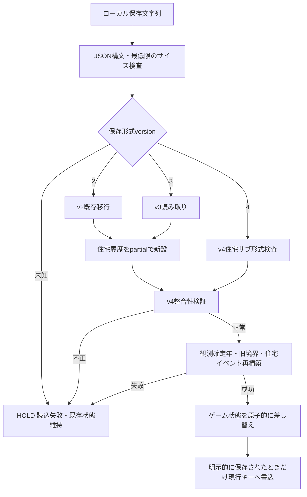

# v0.6 Milestone B / H2 — 住宅街区履歴の保存・旧セーブ移行設計（Humanレビュー用）

**状態：設計案・未承認／実装未着手。** H1はmain統合済み。H2のコード・保存スキーマ・ブラウザ挙動はこのPRでは変更しない。H3（自然進行時の住宅イベント）とH4（描画改善）を範囲外とし、Milestone Bは未完了のままにする。

## 0. 調査の事実と責務

2026-11-05時点のmain：`4e12d04bb7308f289b014c4a789619a3d82ac61b`（PR #12のMerge commit）。mainのCIとGitHub Pagesの自動デプロイはともに成功。既存実装は以下のとおり。

- `src/story/engine.ts`：`CivilizationState.version` は **2|3**、新規ゲームは3。旧2の `migrateCivilization` は人口を第4列の「所在地不明」に入れ、`observation.legacy` に `{year,population,sampleCount,historyCount,memoryCount}` を保持する。既存3をそのまま返す。選択待ちの場合はその年の観測が未確定。
- `src/story/observations.ts`：`ObservationLedger` は `people`、`sites?`、100年チェックポイント・年次人口差分の `blocks`、`lastYear`、`legacy`。`commitObservation` は年次連続を検査し、`observationAt` は確定年だけを復元する。
- `src/story/housing-history.ts`（H1）：`HousingHistory={introducedYear,legacyUntracked,events}`、`housingAt` は `unknown | partial | known` と街区群を再構築する。H1は住宅履歴を `CivilizationState` に接続していない。
- `src/main.ts`：保存は `JSON.stringify(state)` を `localStorage['namonaki-story-v4']` に書き込む。読込はv4→v3→v2キーの順で最初の存在値を読み、`version=2|3` の粗い検証→`migrateCivilization`→`ensureMemory`→`snapshotAt` の順。**ストレージキー末尾のv4は `CivilizationState.version=4` を意味しない。** 読込後は通常の `drawScene(canvas,scene,state.seed)` を呼び、まだ住宅履歴を渡さない。
- 旧セーブ回帰：`tests/fixtures/v05-seed42-year473.json` と `v05-seed82-pending.json`、`tests/observations.test.mjs` およびブラウザの `tests/browser/observations.test.mjs`。10,000年のブラウザ保存・再読込テストもある。
- `.github/workflows/pages.yml` はmainへのpushでGitHub Pagesを再デプロイする。設計PRはDraftで保留し、本番デプロイは行わない。

## 1. 正本の配置とスキーマ境界

### 推奨方針

1. 住宅履歴の正本は、`CivilizationState` の **任意フィールド `housing?: HousingHistory`** とする。既存の人口観測台帳 `observation`、施設履歴 `observation.sites`、文化・経済履歴は変更しない。二重に住宅履歴を保存しない。
2. 新しい保存形式を意味する `CivilizationState.version=4` を導入する。既存 **v2/v3を読み取り対象**として残し、新規作成はv4にする。`housing.schemaVersion=1` を独立に定義する案を推奨。国全体の保存バージョンと住宅サブモデルの形式は別の関心事とする。
3. `HousingHistory.events` が年次の正本。`housingAt` で街区を再生し、現在値キャッシュ `blocks` や `roofParts` は保存しない。描画向け `slotCapacity/roofPartCount` も保存しない。
4. 新規v4ゲームは `housing={schemaVersion:1,introducedYear:0,legacyUntracked:false,events:[]}` を持つ。この場合の住宅ゼロは **known zero（記録済みで未建設）**。H3未導入の間、住宅が自然に建設されないことは仕様上の未実装として明示する。
5. v2/v3からの移行は `housing={schemaVersion:1,introducedYear:boundary,legacyUntracked:true,events:[]}` を新設し、移行前の住宅ストックを**推測・逆算しない**。`introducedYear` より前の `housingAt` は `unknown`、以後は `partial`。移行直後の `partial + []` は「追跡できる住宅がまだない」であり「住宅ゼロ」ではない。
6. 既存v4に住宅履歴が欠損したもの、v3・v2保存形式、保存キーの旧版を**別々に扱う**。形式の判定はJSON内の `version` と住宅サブ形式の検証を正本とし、キー名だけで形式を推測しない。

### 型草案（実装しない）

```ts
type SaveVersion = 2 | 3 | 4;
type HousingSchemaVersion = 1;
type PersistedHousingHistory = HousingHistory & {
  schemaVersion: HousingSchemaVersion;
};
// CivilizationState の読み込みスキーマでは
// version=4: housing は必須（未定義の場合は破損として読込を停止）
// version=2|3: housing がない旧形式を受理し、移行時に追加
// *H1のHousingHistoryにschemaVersionをどう持たせるかは実装PRで型互換を検証する*
```

住宅イベントの不変条件はH1の `housingAt` に従うが、**保存データ全体の検証**は別に設ける。最終的な保存形式の採否はHumanレビューで確定する。

## 2. 移行境界と選択待ち年

移行で新しい住宅の `built` イベントを作成しない。移行は台帳の「追跡開始宣言」であって、住宅建設の歴史ではない。

**推奨境界 `introducedYear = lastObservedYear(save) + 1`**：旧セーブ時点で最後に確定した観測年の**翌年**から新方式のイベントを許可する。ただし、以下の既存仕様を守る。

| 読込元 | 確定年と境界 | 住宅の扱い |
|---|---|---|
| 既存v3・通常年Y（`observation.lastYear=Y`） | `introducedYear=Y+1` | 0..Yはunknown、Y+1以降はpartial |
| v3・選択待ち年Y（通常`lastYear=Y-1`） | `introducedYear=Y` | Y-1まではunknown。選択が確定するまではYの住宅イベントを発生させない |
| v2・通常年Y（旧観測台帳なし） | `introducedYear=Y+1` | 0..Yはunknown。既存の推定情景を保持 |
| v2・選択待ち年Y | `introducedYear=Y+1` **ではなく確定前処理を明示** | 既存 `migrateCivilization` は未確定のYを `legacy.year=Y` として扱い、`step` でY+1を初めて確定観測する。**この旧仕様に合わせ境界はY+1を推奨**。住宅をYに遡及記録しない |
| v4・新規年0 | `introducedYear=0` | 年0からknown。イベントが無ければ記録済みゼロ |

**要Human確認：** v3選択待ち年にYでイベント記録を許すか、それとも全移行で一律 `lastObservedYear+1` とし、Yの確定操作だけが追跡開始契機になるか。上表は既存エンジン上の年確定順序を示す設計草案であり、v2/v3の境界を同一の見かけ上の `state.year` で決め打ちしない。実装前にfixtureで `step`、`choose`、`commitObservation` の順序を再確認する。

特に `CivilizationState.version=3` の既存データは移行済みの旧v2から作られている場合があり、その `observation.legacy` を上書きしない。元の推定境界と新しい住宅の追跡境界は**別々**に保持する。

## 3. 冪等移行と副作用境界

- `migrateCivilization` はv2→v3既存移行→v4住宅初期化、あるいはv3→v4住宅初期化を**一度だけ**実施する。既存v4の二度目のロードはデータ不変。
- 古い `history`、`samples`、`memory.log`、`observation.blocks`、`observation.sites`、`people`、`rngState`、`pending`、`decisions` を遡及更新しない。人口と施設の正本に住宅を合成しない。
- **旧セーブ元のJSON文字列は上書きしない**。読込時の内部移行後、明示的な保存操作によってのみ現行キーにv4形式を書き込む。旧キーは削除しない。
- 読込前に保存データの形状、サイズ、住宅イベントの順序、ブロック不変性、`introducedYear`、イベント年 `<= lastObservedYear`、地点ID、履歴参照の一貫性を検査し、不整合ならHOLD。無効なイベントを黙って削除しない。
- 履歴再構築のための住宅イベントは**純粋関数**として検証する。移行時に `SeededRng` を呼ばず、乱数状態を消費しない。過去観測画像・人口・既存施設台帳は移行前後で一致する。

## 4. 保存・読込フロー案



読み込みは一時的な候補オブジェクトに対して実行し、すべての検証が成功するまでは表示中の文明を変更しない。読み込み失敗時に旧データや現在の表示を破壊しない。現在の `localStorage` 値が存在して不正な場合、暗黙に別キーの古いデータへフォールバックしない（ユーザーの混乱を避け、別キーの復旧は明示操作にする）。

**保存キー案**：既存 `namonaki-story-v4` を維持し、内部 `version=4` に更新する案を第一候補とする。互換を誤認しないため、代替の新キー採用／バックアップ保存の利害はレビュー事項とする。ブラウザの保存容量を超えた場合は明示エラーとし、既存セーブの削除・圧縮・自動書換えは行わない。

## 5. 既存セーブの不変性：比較対象

移行の前後で以下を比較する：

- 確定観測年の `snapshotAt`、`observationAt`、`populationAt`、`siteAt`、`SceneComposition.structures`／`riverUse`。
- 旧セーブ年Y以前の歴史イベント、建物ID・建設年・座標、4列人口、社会制度記録と選択待ちの未確定境界。
- 同一の旧fixtureから移行して保存→読込→同じ選択を実行した場合の `rngState`・総人口・各地点人口・観測更新結果。
- `legacyUntracked=true` の移行後は過去の住宅を描画・保存しない。`partial` に登録された新規イベントだけを描画でき、過去の未記録住宅の有無を推論しない。

**画像の注意：** 新v4ゲームにknownの空住宅履歴を与えても、住宅が未建設なら屋根の追加はゼロ。旧データの描画コードに住宅情報を渡すよう接続する場合、`unknown` と `partial` の画面上の意味をテストし、旧画面を勝手に置換しない。

## 6. H2テスト計画と合格基準

| ID | ケース | 期待結果 |
|---|---|---|
| H2-01 | 新規v4・住宅イベント0件 | `known`、住戸0。従来施設・人口は同一 |
| H2-02 | v3通常年 → v4 | 導入年以前は`unknown`、以降`partial`、新建設イベントなし |
| H2-03 | v3選択待ち年 → v4 | 選択確定前に未確定年の住宅イベントを記録しない |
| H2-04 | v05 seed42/year473 → v4 | 0..473年の旧観測・既存情景が変化しない |
| H2-05 | v05 seed82/pending → v4 | 選択待ち・再開・境界直後の既存観測が一致 |
| H2-06 | 旧v2移行後v3セーブ → v4 | 従来の`observation.legacy`と第4人口列を維持 |
| H2-07 | 同一保存を2回移行 | 2回目は完全に同一の状態で副作用なし |
| H2-08 | 建設／損傷／廃墟／修繕／再利用の保存再読込 | 同一年・同一地点で`housingAt`と`SceneComposition`が一致 |
| H2-09 | 不正な住宅イベント・未知のschemaVersion | 読込失敗。既存状態・ローカル保存を維持 |
| H2-10 | 履歴に未来年・不正`seq`・矛盾する`legacyUntracked` | 読込拒否。部分適用なし |
| H2-11 | 保存・ロード・同じ選択で再開 | `rngState`、人口、個別施設、住宅イベントが決定的に一致 |
| H2-12 | Chromiumローカル保存・読込・巻戻し・地点切替 | 原寸Canvasが同じ。別ブラウザキーのセーブは不変 |
| H2-13 | 10,000年の保存容量・再構築時間 | 現行ブラウザの容量内で完了。容量超過は明示的にHOLD |
| H2-14 | v4で住宅フィールド欠損・余分な不正属性 | 既知の不正形式として拒否（意図しない暗黙補完なし） |
| H2-15 | 新規v4イベントが存在しない旧年を指す | 追跡開始前の履歴改変を拒否 |

**回帰コマンド案：** `npm test` と `npm run test:browser`。既存のseed42/82 fixtureを保持し、H2専用の新規fixtureを追加する（旧fixtureの上書き禁止）。ビルド、全ロジック・ブラウザテスト、画像一致、保存前後の履歴差分を証拠として残す。

## 7. 実装分割案（本PRでは行わない）

- **H2-A：形式・読み込み検証。** `version=4`、住宅サブ形式1、厳格な形式検査、移行境界の純粋な判定、旧v2/v3 fixtures。UI操作や新規建設なし。
- **H2-B：保存・読込への原子的な接続。** `src/main.ts` の読み込みと保存を新形式に対応させ、明示保存前に旧キーを変更しない。再開後の決定性を検証。
- **H2-C：描画接続とブラウザ回帰。** `drawScene` にその年の保存住宅履歴を渡す。ただし旧記録の`unknown`を新しい建物へ変換しない。巻戻し・地点切替・10,000年保存のブラウザテスト。
- H2完了後もH3は独立工程。自然進行で建設を許す前に**丘陵・入り江の地形検証と後発施設HOLD**を必須とする。

## 8. Humanレビューで決める事項

1. **移行境界年：** v3選択待ち年の追跡開始をYにするかY+1にするか。既存v2 pendingは移行年の観測が作られず、Y+1が最初の確定観測となる点を優先。
2. **保存キー：** `namonaki-story-v4` を現行キーとして継続するか、H2導入に合わせ新キーとするか。バージョン判定は内部スキーマで行う。
3. **v4の住宅フィールド必須性：** 新しい保存形式では必須（推奨）。欠損を旧v3として自動推定しない。
4. **移行後の表示：** `partial` を未記録住宅のゼロと誤認させないUI表現をH2の最低限に含めるか。推奨は**新築の実記録だけを表示し、未記録は明示的に不明と扱う**。
5. **誤形式時の停止／復旧：** 破損保存はHOLD、既存の画面と保存キーは無変更とし、利用者の明示操作なく上書きしない。

**結論：** H2は住宅履歴を保存できるようにする工程であり、失われた過去を創作して補う工程ではない。実装承認まではこの設計Draftだけを維持し、mainへのマージ・本番反映・H3/H4着手をしない。
