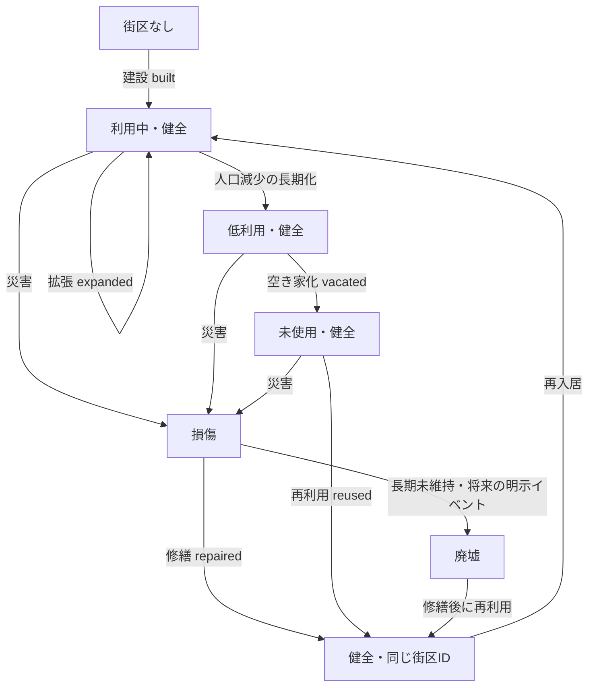

# v0.6 Milestone B — 住宅ストック・街区履歴モデル設計（Humanレビュー用）

**状態：設計案／未承認。** 今回はシミュレーション、保存スキーマ、移行処理、描画処理を変更しない。PR #9はDraftのまま、Milestone Bは未完了とする。

## 0. 調査時点のリポジトリ状態（2026-11-05）

- main：`70c907c1ffee203522196e12311254fbc76fedb2`
- PR #8はmainへマージ済み。PR #9は本書作成前のHEAD `1e65d50982a9b49ab555c08f6f444a5a98250c0a` でDraft・未マージ。
- PR #9のベースはmainではなく、PR #8の旧作業ブランチ `feat/v06-visual-enhancement-a`。今回の設計作業ではベースを変更しない。
- 調査対象：`src/story/settlement-history.ts`、`population.ts`、`observations.ts`、`src/scene/model.ts`、`composition.ts`、`draw.ts`、`docs/v0.6-milestone-b-boundary.md`。Milestone AでHuman承認済みのネイティブ解像度プロトタイプを視覚的な合格基準とする。ただし、**そのプロトタイプは観測台帳ではない**。

## 1. 現状の課題と正本の責務

- `settlement-history.ts` には地点ごとに11個の固定建設候補区画があり、住宅は3区画のみ。`Building` はID・種類・座標・建設年・状態、および任意の再利用フラグと記録IDを持つ。`buildingChanges` は建物の変更後状態を保存し、`siteAt` が指定年時点の状態を復元する。
- 居住規模は人口、施設、交易継続年数、食糧充足度、成長・縮小の継続期間から判定する。この**分類結果だけで住宅を新設してはならない**。
- `population.ts` は3地点の人口列に加え、旧セーブ移行で利用する4番目の「所在地不明」人口列を定義する。`changePopulation` が変化を配分し、`observations.ts` が100年ごとのチェックポイントと差分で各年の人口を再構築する。人口の正本は既に確立している。
- `scene/model.ts` は確定観測から `SiteSnapshot` を作成し、旧セーブ境界を別扱いする。`scene/composition.ts` は記録済み施設を描画対象へ投影し、`draw.ts` は320×180pxで描画する。現行の `ComposedBlock` は既存施設の周囲の地表表現にすぎず、**歴史を持つ住宅街区ではない**。現在の描画モデルだけでは、承認済みMilestone Aの都市の住宅シルエットを再現できない。
- VisualProfileの `roadLevel`・`squareLevel`・`riversideLevel` を、実際の道路・船着き場・公共建築・市場が建設された証拠として扱わない。

## 2. A案とB案の比較

| 評価軸 | A案：地点ごとの最小集合住宅ストック | B案：街区ごとの詳細管理 |
|---|---|---|
| データ | 上限付きの安定した街区群、住宅数、粗い利用・損傷状態 | 街区ごとの住戸、居住率、損傷、詳細な形態 |
| 実装規模 | 小〜中。既存の年指定履歴に組み込みやすい | 大。因果関係と復旧処理が複雑 |
| 保存サイズ | O(街区数＋状態遷移数)、地点ごとに上限設定可 | 地点・住戸ごとに多数の変更が発生し得る |
| 再現性 | 不変ID・位置と追記型イベントで確保しやすい | 確保可能だが検証対象が広い |
| 旧セーブ | 移行境界の後だけ新履歴を開始 | 同じ原則だが初期化が複雑 |
| 10,000年性能 | 疎なイベントとチェックポイントが有効 | 圧縮・索引化が必要になりやすい |
| 視覚表現 | 複数の安定した街区と屋根バリエーションで初期都市を表現可能 | 将来的により細かな地区特性を表現可能 |

**推奨：A+案（最小構成の街区ごとに履歴を持つ方式）。** 地点全体の住宅数を1つの数字で持つだけでは、縮小後も同じ場所に残る街区を再現できない。一方、世帯や個別住宅まで独立シミュレーションする詳細B案は、現在記録していない社会情報を見た目のために仮定する危険があり、複雑さに見合わない。

## 3. データ型草案（TypeScriptには未実装）

```ts
type BlockId = string;
type SiteId = 'river-bank' | 'hill-side' | 'coast-inlet';
type BlockCondition = 'sound' | 'damaged' | 'ruined';
type UseState = 'occupied' | 'underused' | 'vacant';
type HousingEventKind = 'built' | 'expanded' | 'damaged' | 'repaired' | 'vacated' | 'reused';

interface PlotGeometry {
  // タイル座標で固定する敷地外接矩形。地形・橋・既存個別建物・他の街区との重複を検査する。
  x: number; y: number; width: number; depth: number;
}
interface ResidentialBlock {
  blockId: BlockId; siteId: SiteId;
  footprint: PlotGeometry; builtYear: number;
  styleSeed: number; // 一度だけ確定し、シミュレーション用乱数を消費しない
  housingCount: number; // ストックとしての住戸数。0以上の整数
  condition: BlockCondition;
  use: UseState; // 粗い利用状態。人口の第2の正本ではない
  lastRenovatedYear?: number;
}
interface ResidentialBlockEvent {
  year: number;
  seq: number; // 同一年に複数の変更がある場合の順序
  blockId: BlockId;
  kind: HousingEventKind;
  after: ResidentialBlock; // 変更後の完全な状態。ID・敷地は不変
  causeRecordId?: string;
}
interface HousingHistory {
  introducedYear: number; // 新規開始または旧セーブ移行の境界年
  blocks: ResidentialBlock[]; // 現在状態のキャッシュ。歴史の唯一の正本ではない
  changes: ResidentialBlockEvent[];
}
```

変更後状態をイベントに持たせる方法は、既存の `buildingChanges` の再構築方式に合わせる。ID、敷地形状、`styleSeed`、`builtYear` の不変性はイベント適用時に毎回検証する。将来の `repurposed`（用途転換）には非住宅用途の別設計が必要なため、初期実装から除外する。住宅街区は橋・市場・穀物庫・集会所・仕事場を代理してはならない。それらは従来どおり個別施設台帳の `Building` に記録する。

**保存しない属性：`occupiedPopulation`。** 正本である地点人口と決定的な配分規則から観測用に導出し、独立して書き換え可能な数値として保存しない。**`capacity` も独立保存しない。** 初期段階では表示・評価用に `nominalCapacity = housingCount * capacityPerUnit` で導出し、計算規則をバージョン管理したうえで「目安」と明示する。将来、本当の歴史的収容能力を扱うなら、規則変更で過去の能力が変わることを避けるため、イベントで記録する物理属性として追加する。住戸数と人口には厳密な1対1関係を仮定しない。

`use` は物理的な利用状況の粗い表現であり、正確な居住者数ではない。`vacant` は**街区全体が未使用**であることを表す。一部だけ空き家なら `underused` を使用する。より細かい精度が必要になった場合、根拠のない使用率より `activeHousingCount` を検討するが、測定結果と画面上の必要性が明らかになるまで導入しない。

### 状態遷移とイベントの検証条件

- `built`：一意な新規街区ID、重複しない固定敷地、年が `introducedYear` 以降、`housingCount > 0`。初期利用状態は明示した初期化規則による。橋・市場は生成しない。
- `expanded`：同じ許可敷地内に空間がある場合のみ `housingCount` を増やす。空間がなければ別IDの新街区を建設する。敷地サイズを暗黙に変更しない。増築後も街区の創設年と敷地形状を保持し、建築様式の改修は将来別途イベント化する。
- `damaged`：`sound` → `damaged`。住宅ストックと敷地は残す。
- `repaired`：`damaged` → `sound`。廃墟からの復旧は明示的な修繕判断を伴う場合のみ認める。修繕年を記録する。
- `vacated`：`occupied` または `underused` → `vacant`。`housingCount` はゼロにならず、別の損傷イベントがなければ物理状態も変えない。
- `reused`：`vacant` → `underused`／`occupied`、または廃墟を明示的な修繕イベントの後に再利用する。IDと建設年を保持する。
- 長期的な取り壊し・撤去には、将来**明示的な `demolished` イベント**が必要であり、人口・規模による自動消失は禁止する。初期範囲には含めない。

状態遷移の概念図：



**注意：** 図は可能な遷移を示すもので、人口が変わるたびに毎年イベントが発生する仕様ではない。長期間の利用低下を `use` に記録する場合は、継続期間の閾値と確定イベントを定義する。規模の呼称変更だけで街区を生成してはならない。

## 4. 人口台帳との整合ルール

- **既存の人口台帳を唯一の正本とする。** 観測年Yの地点人口は `observationAt` から取得する。3地点の住民数と「所在地不明」の住民数の合計が `observationAt(...).population` に一致する。住宅への配分によって元の値を変更してはならない。
- 描画専用の任意の配分では、居住可能な街区に対し、街区IDの安定した順序、利用可能な住戸数、名目収容力を使って、地点人口を超えない範囲で決定的に配分する。収容できない人数は `unallocated` として明示し、架空の建物や負の人数で埋め合わせない。人物の正確な割当数は永続化せず、画面上では粗い利用段階だけを導出できる。第4列の所在地不明人口は既知の街区に割り当てない。
- **住宅容量は人口を制限しない。** 今回は出生・死亡・移住・総人口・地点人口の計算を変更しない。人口が名目収容力を上回れば過密の診断値を出すだけにする。
- 人口増加：長期間の住民増加と資源条件が建設・拡張の理由になり得るが、クールダウンと空き敷地を確認してイベント化する。人口増加の瞬間に建設することはない。都市という分類は建設の必要条件でも十分条件でもない。
- 人口減少：住民が離れても物理的な建物は直ちに消えない。利用度が低下し、条件が継続した場合に `underused` や `vacated` を確定する。屋根・道路・敷地は残す。
- 急増・急減：人口は既存ルールに従い即時変化するが、住宅は明示的な物理変更イベントがある場合にのみ変化する。一時的な過密・余剰を許す。
- 住宅ストックの更新処理では人口計算を実行しない。既存の `changePopulation` と住宅政策を分離する。

## 5. 具体的な4つの歴史例

1. **集落から都市へ：** 街区Aを30年、Bを115年、Cを260年に別々の `built` イベントで建設する。持続的な需要と空間があれば後年に `expanded` を記録できる。居住規模の変更だけでは新しい街区は出現しない。これらの年は**設計説明用の仮例であり、自然進行の結果ではない**。
2. **都市から村へ縮小：** 700年に人口が減っても街区A・B・Cは元の座標に残る。ある街区は `underused` になり、別の街区はその後の年に `vacated` イベントを受ける。道路、屋根、傷んだ建材は残り、人間の活動だけが減る。
3. **放棄街区の再利用：** 700年に未使用となった街区X（建設年100年）を780年に `reused` する。新IDや新しい創設年は付けない。損傷しているなら先に修繕イベントが必要。
4. **旧セーブの読込：** 移行境界500年の旧セーブには住宅街区の台帳がない。500年以前に遡る街区を推定・確定してはならない。以前の観測では旧描画を維持し、新履歴は明示した `introducedYear` より後から記録する。初期化時に街区履歴が空でも、**「不明」であって「建物が存在しなかった証拠」ではない**。読込時に架空の建設イベントは発行しない。初期案では `legacyUntracked` として未記録の状態を保持し、移行後に本当に新しい建設・再利用イベントが起こった時点から追跡する。このため、旧セーブの都市では新方式の住宅シルエットが当初薄くなることがあるが、履歴を捏造しないための意図的な制限とする。必要なら推定であることを明確に示す一時的な視覚マスクを検討できるが、確定した街区・道路として保存しない。既存施設のIDと予約済み敷地は保持する。

移行実装前に承認する詳細：保存済み観測情報に任意の `housingHistory`（またはトップレベルの同階層フィールド）を追加し、バージョンと `introducedYear` を明記する。旧観測範囲、サンプル、乱数状態を書き換えない。既存の `LegacyBoundary` と所在地不明人口列は別々に扱う。未確定の選択肢がある場合、現在の `year` を無条件で履歴開始年にしない。既存のセーブfixtureを保護し、境界以前の観測結果をビット単位で比較する。

## 6. SceneCompositionへの接続

```text
確定済み観測（年、地点人口、個別施設、傾向）
  ＋ 指定年時点のHousingHistory（街区、変更履歴）
  → 純粋関数 buildSceneComposition
      既存施設のスプライト（正確なID・種類・状態）
      住宅街区のシルエット（街区ID、不変の敷地、建設時の様式）
      決定的な屋根部品（街区内のみ。新たな個別施設IDではない）
      利用・草地化表現（記録済みの状態からのみ導出）
      道路・広場・河岸施設（別の正本履歴で成立した場合のみ）
  → 320×180px描画（固定カメラ、奥行き順、シミュレーション乱数に非依存）
```

屋根の各部品は `blockId + spriteIndex` の識別子を使い、不変の `styleSeed`、`housingCount`、元の敷地、建設時代から局所位置を決定する。`expanded` 後も古い屋根の形状・素材・座標は並べ替えず、空いている予約位置に新しいインデックスを追加する。住戸数の減少だけで既存の物理的な屋根を削除せず、取り壊しがある場合は明示イベントを必要とする。遠景・中景・前景の3段階で細部を変え、住宅・仕事場・集会所には異なるスプライト系列を用いる。道路・公園・河岸の描画について、**単なる地表の演出**なのか**履歴上成立した施設**なのかを区別し、未記録の舗装道路や桟橋を実在施設と誤認させない。

現行PR #9の `ComposedBlock` は施設に付随する**描画専用地表**であり、`ResidentialBlock` とは別物である。将来 `FacilitySurrounding` に改名し、正本の責務を混同しない。

## 7. 今後の実装PR分割案（今回実施しない）

- **PR H1：型定義・履歴再構築。** オプトインで型、検証、イベントリデューサー、固定敷地形状、`housingAt(site,year)` を追加。シミュレーション変更なし。合成した確定イベントでテストする。
- **PR H2：前方のみの永続化・移行。** 任意の履歴、`introducedYear`、境界、保存・読込、v0.5 fixtureを扱う。過去への補完は禁止。旧年代の再生ハッシュを維持する。
- **PR H3：人口非干渉の住宅イベント方針。** 上限付きの建設、拡張、低利用、空き家化、修繕、再利用。クールダウン、座標固定、原因追跡を実装する。
- **PR H4：描画接続。** `SceneComposition` と住宅街区・屋根スプライトを接続。原寸／4倍画像、自然進行／固定fixtureの出典区別、性能調整を実施する。
- **PR H5：統合検証。** 2,000年・10,000年試走、縮小・放棄・再利用、保存復元、地点切替、1,000年巻き戻し、Humanによる視覚承認を行う。これらが完了するまでPR #9およびMilestone Bを完了扱いにしない。

## 8. テスト計画と観測指標

**単体・不変条件：** 街区IDの全体一意性、敷地・様式・建設年の不変性、建物・川・既存施設との重複防止、住宅ストック非負、配分人口非負、`sum(3地点人口 + 所在地不明人口) === 総人口`、住宅処理による人口・乱数状態の不変、イベントの年・`seq` 昇順、許可外遷移の拒否、架空の公共施設の不存在、屋根が記録された住宅ストックにのみ由来すること。

**過去再現・互換：** 同一シード・年・地点・セーブから同じ街区・ピクセルを得る。後年の進行後も過去の `housingAt` が不変。JSON保存復元で一致。旧セーブの移行境界以前の観測画像が不変。境界以前の新街区イベントがゼロ。選択肢保留時の境界、所在地不明人口、既存v0.5 seed42/82 fixtureを検証する。

**ブラウザ・視覚：** 320×180px固定カメラ、最近傍4倍、地点切替、再読込、1,000年自動進行、2,000年・10,000年の通し試走、都市から村への縮小、損傷・再利用、自然進行画像と固定fixtureを区別。画像ハッシュの違いだけでなく、土地利用・街区の自然さをHumanが確認する。

**地点別・100年単位の指標：** 建設・拡張・空き家化・再利用イベント数、10年当たりの変更数、イベント間隔p95、利用中・未使用・損傷の街区数、残存住戸数、名目1住戸当たり人数（診断用）、未配分・過密、イベントなしに隣接する年の画像間で移動した既存屋根の割合（必ずゼロ）、自然・道路・住宅・公共空間が占める画像面積比、過去年再生時間p50/p95、2,000年・10,000年時点のセーブサイズ。空き家化と再利用の短期反復、不自然な屋根密度、敷地上限への到達を警告対象とする。閾値は事前の憶測で固定せず、試走結果から調整する。

## 9. 性能・保存容量・リスクと判断事項

- 地点ごとの街区数・位置候補に上限を設け、状態変化イベントを疎に記録する。個人ごと、または街区ごとの毎年イベントは保存しない。過去再生では最新チェックポイントから順に変更を適用し、必要になればNイベントごとにスナップショットを置く。
- **主要リスク：** 建設記録が十分に増える前は、都市と分類されても住宅景観が薄い。架空の屋根で解決しない。
- **主要リスク：** 旧セーブの未記録住宅は「不明」と「ゼロ」を区別する。確実性のない既存住宅をどう表示するかはHuman承認が必要。
- **主要リスク：** 既存11施設区画との重複。各地点の実際の地形とカメラ座標に合わせ、別の陸地区画グリッドを確保・検証する。
- **主要リスク：** 変更可能な規則から `styleSeed` を導出すると、バージョン更新で過去の外観が変わる。固定の様式識別子と描画スキーマ版を保存し、画像ゴールデンテストを行う。
- **主要リスク：** 10,000年でイベントが無制限に増える。チェックポイント間隔の決定前に保存容量と再生時間を実測する。

### Humanレビューで決める事項

1. 旧セーブ移行時に住宅ストックを保守的な「空／未記録」として扱い、旧都市のシルエットが当初薄くなることを許容するか。
2. 初期は `underused` という粗い状態で十分か。部分空き家の履歴に `activeHousingCount` が必要か。
3. 320×180px内で既存施設と衝突せず確保できる、地点ごとの住宅街区数と位置候補の上限はいくつか。
4. 道路・河岸・土地利用の確定履歴を住宅イベントと別マイルストーンで扱うか。**推奨：分離する。**

## 10. PRベースをmainへ整理する手順（計画のみ・未実施）

PR #8がmainへマージ済みのため、PR #9は最終的にmainをベースにするのが望ましい。まずマージコミットと祖先関係、差分を確認し、PR #8の内容がmainに取り込まれていることを検証する。PR #9の現在HEAD、ステータスチェック、mainの追加コミットを記録する。その後、**PR #9のHEADを変更せずにベースだけmainへ変更**し、変更ファイルとコミット一覧を確認する。マージ方法の影響でPR #8の変更などが意図せず再表示された場合は**作業停止**。mainから新しいクリーンブランチを作り、PR #9固有のコミットだけをcherry-pickして代替Draft PRに分ける。Human承認なしにPR #9を履歴改変・force pushしない。CIと独立レビューを再実施する。この文書作成によってベースは変更しない。

## 結論

**推奨はA+案。Humanレビューに提出し、設計承認まで実装を開始しない。** PRのマージやMilestone Bの完了宣言も行わない。
