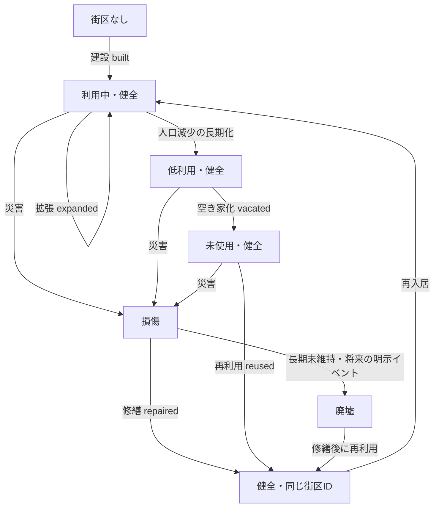

# v0.6 Milestone B — 住宅ストック・街区履歴モデル設計（Humanレビュー用）

**状態：A+基本方針は条件付き承認／住宅街区数上限はHuman再レビュー待ち。** 今回はシミュレーション、保存スキーマ、移行処理、描画処理を変更しない。PR #9はDraftのまま、Milestone Bは未完了とする。

## 0. 調査時点のリポジトリ状態（2026-11-05）

- main：`70c907c1ffee203522196e12311254fbc76fedb2`
- PR #8はmainへマージ済み。PR #9は本書作成前のHEAD `1e65d50982a9b49ab555c08f6f444a5a98250c0a` でDraft・未マージ。
- PR #9のベースはmainではなく、PR #8の旧作業ブランチ `feat/v06-visual-enhancement-a`。今回の設計作業ではベースを変更しない。
- 調査対象：`src/story/settlement-history.ts`、`population.ts`、`observations.ts`、`src/scene/model.ts`、`composition.ts`、`draw.ts`、`docs/v0.6-milestone-b-boundary.md`。Milestone AでHuman承認済みのネイティブ解像度プロトタイプを視覚的な合格基準とする。ただし、**そのプロトタイプは観測台帳ではない**。

## 1. 現状の課題と正本の責務

- `settlement-history.ts` には地点ごとに11個の固定建設候補区画があり、住宅は3区画のみ。`Building` はID・種類・座標・建設年・状態、および任意の再利用フラグと記録IDを持つ。`buildingChanges` は建物の変更後状態を保存し、`siteAt` が指定年時点の状態を復元する。
- 居住規模は人口、施設、交易継続年数、食糧充足度、成長・縮小の継続期間から判定する。この**分類結果だけで住宅を新設してはならない**。
- `population.ts` は3地点の人口列に加え、旧セーブ移行で利用する4番目の「所在地不明」人口列を定義する。`changePopulation` が変化を配分し、`observations.ts` が100年ごとのチェックポイントと差分で各年の人口を再構築する。人口の正本は既に確立している。
- `scene/model.ts` は確定観測から `SiteSnapshot` を作成し、旧セーブ境界を別扱いする。`scene/composition.ts` は記録済み施設を描画対象へ投影し、`draw.ts` は320×180pxで描画する。現行の `ComposedBlock` は既存施設の周囲の地表表現にすぎず、**歴史を持つ住宅街区ではない**。現在の描画モデルだけでは、承認済みMilestone Aの都市の住宅シルエットを再現できない。
- VisualProfileの `roadLevel`・`squareLevel`・`riversideLevel` を、実際の道路・船着き場・公共建築・市場が建設された証拠として扱わない。

## 2. A案とB案の比較

| 評価軸 | A案：地点ごとの最小集合住宅ストック | B案：街区ごとの詳細管理 |
|---|---|---|
| データ | 上限付きの安定した街区群、住宅数、粗い利用・損傷状態 | 街区ごとの住戸、居住率、損傷、詳細な形態 |
| 実装規模 | 小〜中。既存の年指定履歴に組み込みやすい | 大。因果関係と復旧処理が複雑 |
| 保存サイズ | O(街区数＋状態遷移数)、地点ごとに上限設定可 | 地点・住戸ごとに多数の変更が発生し得る |
| 再現性 | 不変ID・位置と追記型イベントで確保しやすい | 確保可能だが検証対象が広い |
| 旧セーブ | 移行境界の後だけ新履歴を開始 | 同じ原則だが初期化が複雑 |
| 10,000年性能 | 疎なイベントとチェックポイントが有効 | 圧縮・索引化が必要になりやすい |
| 視覚表現 | 複数の安定した街区と屋根バリエーションで初期都市を表現可能 | 将来的により細かな地区特性を表現可能 |

**推奨：A+案（最小構成の街区ごとに履歴を持つ方式）。** 地点全体の住宅数を1つの数字で持つだけでは、縮小後も同じ場所に残る街区を再現できない。一方、世帯や個別住宅まで独立シミュレーションする詳細B案は、現在記録していない社会情報を見た目のために仮定する危険があり、複雑さに見合わない。

## 3. データ型草案（TypeScriptには未実装）

```ts
type BlockId = string;
type SiteId = 'river-bank' | 'hill-side' | 'coast-inlet';
type BlockCondition = 'sound' | 'damaged' | 'ruined';
type UseState = 'occupied' | 'underused' | 'vacant';
type HousingEventKind = 'built' | 'expanded' | 'damaged' | 'ruined' | 'repaired' | 'underused' | 'vacated' | 'reused';

interface PlotGeometry {
  // タイル座標で固定する敷地外接矩形。地形・橋・既存個別建物・他の街区との重複を検査する。
  x: number; y: number; width: number; depth: number;
}
interface ResidentialBlock {
  blockId: BlockId; siteId: SiteId;
  footprint: PlotGeometry; builtYear: number;
  styleSeed: number; // 一度だけ確定し、シミュレーション用乱数を消費しない
  housingCount: number; // ストックとしての住戸数。0以上の整数
  condition: BlockCondition;
  use: UseState; // 粗い利用状態。人口の第2の正本ではない
  lastRenovatedYear?: number;
}
interface ResidentialBlockEvent {
  year: number;
  seq: number; // 同一年に複数の変更がある場合の順序
  blockId: BlockId;
  kind: HousingEventKind;
  after: ResidentialBlock; // 変更後の完全な状態。ID・敷地は不変
  causeRecordId?: string;
}
interface HousingHistory {
  introducedYear: number; // 新規開始または旧セーブ移行の境界年
  blocks: ResidentialBlock[]; // 現在状態のキャッシュ。歴史の唯一の正本ではない
  changes: ResidentialBlockEvent[];
}
```

変更後状態をイベントに持たせる方法は、既存の `buildingChanges` の再構築方式に合わせる。ID、敷地形状、`styleSeed`、`builtYear` の不変性はイベント適用時に毎回検証する。将来の `repurposed`（用途転換）には非住宅用途の別設計が必要なため、初期実装から除外する。住宅街区は橋・市場・穀物庫・集会所・仕事場を代理してはならない。それらは従来どおり個別施設台帳の `Building` に記録する。

**保存しない属性：`occupiedPopulation`。** 正本である地点人口と決定的な配分規則から観測用に導出し、独立して書き換え可能な数値として保存しない。**`capacity` も独立保存しない。** 初期段階では表示・評価用に `nominalCapacity = housingCount * capacityPerUnit` で導出し、計算規則をバージョン管理したうえで「目安」と明示する。将来、本当の歴史的収容能力を扱うなら、規則変更で過去の能力が変わることを避けるため、イベントで記録する物理属性として追加する。住戸数と人口には厳密な1対1関係を仮定しない。

`use` は物理的な利用状況の粗い表現であり、正確な居住者数ではない。`vacant` は**街区全体が未使用**であることを表す。一部だけ空き家なら `underused` を使用する。より細かい精度が必要になった場合、根拠のない使用率より `activeHousingCount` を検討するが、測定結果と画面上の必要性が明らかになるまで導入しない。

### 状態遷移とイベントの検証条件

- `built`：一意な新規街区ID、重複しない固定敷地、年が `introducedYear` 以降、`housingCount > 0`。初期利用状態は明示した初期化規則による。橋・市場は生成しない。
- `expanded`：同じ許可敷地内に空間がある場合のみ `housingCount` を増やす。空間がなければ別IDの新街区を建設する。敷地サイズを暗黙に変更しない。増築後も街区の創設年と敷地形状を保持し、建築様式の改修は将来別途イベント化する。
- `damaged`：`sound` → `damaged`。住宅ストックと敷地は残す。
- `repaired`：`damaged` → `sound`。廃墟からの復旧は明示的な修繕判断を伴う場合のみ認める。修繕年を記録する。
- `underused`：`occupied` → `underused`。街区の一部の住宅が使われなくなったことを示す明示イベント。物理状態と住宅数は維持する。
- `ruined`：既に損傷している街区が、十分な期間の未維持など明示した原因により `ruined` へ移る。イベントなしの経年自動変更は禁止。
- `vacated`：`occupied` または `underused` → `vacant`。`housingCount` はゼロにならず、別の損傷イベントがなければ物理状態も変えない。
- `reused`：`vacant` → `underused`／`occupied`、または廃墟を明示的な修繕イベントの後に再利用する。IDと建設年を保持する。
- 長期的な取り壊し・撤去には、将来**明示的な `demolished` イベント**が必要であり、人口・規模による自動消失は禁止する。初期範囲には含めない。

状態遷移の概念図：



**注意：** 図は可能な遷移を示すもので、人口が変わるたびに毎年イベントが発生する仕様ではない。長期間の利用低下を `use` に記録する場合は、継続期間の閾値と確定イベントを定義する。規模の呼称変更だけで街区を生成してはならない。

## 4. 人口台帳との整合ルール

- **既存の人口台帳を唯一の正本とする。** 観測年Yの地点人口は `observationAt` から取得する。3地点の住民数と「所在地不明」の住民数の合計が `observationAt(...).population` に一致する。住宅への配分によって元の値を変更してはならない。
- 描画専用の任意の配分では、居住可能な街区に対し、街区IDの安定した順序、利用可能な住戸数、名目収容力を使って、地点人口を超えない範囲で決定的に配分する。収容できない人数は `unallocated` として明示し、架空の建物や負の人数で埋め合わせない。人物の正確な割当数は永続化せず、画面上では粗い利用段階だけを導出できる。第4列の所在地不明人口は既知の街区に割り当てない。
- **住宅容量は人口を制限しない。** 今回は出生・死亡・移住・総人口・地点人口の計算を変更しない。人口が名目収容力を上回れば過密の診断値を出すだけにする。
- 人口増加：長期間の住民増加と資源条件が建設・拡張の理由になり得るが、クールダウンと空き敷地を確認してイベント化する。人口増加の瞬間に建設することはない。都市という分類は建設の必要条件でも十分条件でもない。
- 人口減少：住民が離れても物理的な建物は直ちに消えない。利用度が低下し、条件が継続した場合に `underused` や `vacated` を確定する。屋根・道路・敷地は残す。
- 急増・急減：人口は既存ルールに従い即時変化するが、住宅は明示的な物理変更イベントがある場合にのみ変化する。一時的な過密・余剰を許す。
- 住宅ストックの更新処理では人口計算を実行しない。既存の `changePopulation` と住宅政策を分離する。

## 5. 具体的な4つの歴史例

1. **集落から都市へ：** 街区Aを30年、Bを115年、Cを260年に別々の `built` イベントで建設する。持続的な需要と空間があれば後年に `expanded` を記録できる。居住規模の変更だけでは新しい街区は出現しない。これらの年は**設計説明用の仮例であり、自然進行の結果ではない**。
2. **都市から村へ縮小：** 700年に人口が減っても街区A・B・Cは元の座標に残る。ある街区は `underused` になり、別の街区はその後の年に `vacated` イベントを受ける。道路、屋根、傷んだ建材は残り、人間の活動だけが減る。
3. **放棄街区の再利用：** 700年に未使用となった街区X（建設年100年）を780年に `reused` する。新IDや新しい創設年は付けない。損傷しているなら先に修繕イベントが必要。
4. **旧セーブの読込：** 移行境界500年の旧セーブには住宅街区の台帳がない。500年以前に遡る街区を推定・確定してはならない。以前の観測では旧描画を維持し、新履歴は明示した `introducedYear` より後から記録する。初期化時に街区履歴が空でも、**「不明」であって「建物が存在しなかった証拠」ではない**。読込時に架空の建設イベントは発行しない。初期案では `legacyUntracked` として未記録の状態を保持し、移行後に本当に新しい建設・再利用イベントが起こった時点から追跡する。このため、旧セーブの都市では新方式の住宅シルエットが当初薄くなることがあるが、履歴を捏造しないための意図的な制限とする。必要なら推定であることを明確に示す一時的な視覚マスクを検討できるが、確定した街区・道路として保存しない。既存施設のIDと予約済み敷地は保持する。

移行実装前に承認する詳細：保存済み観測情報に任意の `housingHistory`（またはトップレベルの同階層フィールド）を追加し、バージョンと `introducedYear` を明記する。旧観測範囲、サンプル、乱数状態を書き換えない。既存の `LegacyBoundary` と所在地不明人口列は別々に扱う。未確定の選択肢がある場合、現在の `year` を無条件で履歴開始年にしない。既存のセーブfixtureを保護し、境界以前の観測結果をビット単位で比較する。

## 6. SceneCompositionへの接続

```text
確定済み観測（年、地点人口、個別施設、傾向）
  ＋ 指定年時点のHousingHistory（街区、変更履歴）
  → 純粋関数 buildSceneComposition
      既存施設のスプライト（正確なID・種類・状態）
      住宅街区のシルエット（街区ID、不変の敷地、建設時の様式）
      決定的な屋根部品（街区内のみ。新たな個別施設IDではない）
      利用・草地化表現（記録済みの状態からのみ導出）
      道路・広場・河岸施設（別の正本履歴で成立した場合のみ）
  → 320×180px描画（固定カメラ、奥行き順、シミュレーション乱数に非依存）
```

屋根の各部品は `blockId + spriteIndex` の識別子を使い、不変の `styleSeed`、`housingCount`、元の敷地、建設時代から局所位置を決定する。`expanded` 後も古い屋根の形状・素材・座標は並べ替えず、空いている予約位置に新しいインデックスを追加する。住戸数の減少だけで既存の物理的な屋根を削除せず、取り壊しがある場合は明示イベントを必要とする。遠景・中景・前景の3段階で細部を変え、住宅・仕事場・集会所には異なるスプライト系列を用いる。道路・公園・河岸の描画について、**単なる地表の演出**なのか**履歴上成立した施設**なのかを区別し、未記録の舗装道路や桟橋を実在施設と誤認させない。

現行PR #9の `ComposedBlock` は施設に付随する**描画専用地表**であり、`ResidentialBlock` とは別物である。将来 `FacilitySurrounding` に改名し、正本の責務を混同しない。

## 7. 今後の実装PR分割案（今回実施しない）

- **PR H1：型定義・履歴再構築。** オプトインで型、検証、イベントリデューサー、固定敷地形状、`housingAt(site,year)` を追加。シミュレーション変更なし。合成した確定イベントでテストする。
- **PR H2：前方のみの永続化・移行。** 任意の履歴、`introducedYear`、境界、保存・読込、v0.5 fixtureを扱う。過去への補完は禁止。旧年代の再生ハッシュを維持する。
- **PR H3：人口非干渉の住宅イベント方針。** 上限付きの建設、拡張、低利用、空き家化、修繕、再利用。クールダウン、座標固定、原因追跡を実装する。
- **PR H4：描画接続。** `SceneComposition` と住宅街区・屋根スプライトを接続。原寸／4倍画像、自然進行／固定fixtureの出典区別、性能調整を実施する。
- **PR H5：統合検証。** 2,000年・10,000年試走、縮小・放棄・再利用、保存復元、地点切替、1,000年巻き戻し、Humanによる視覚承認を行う。これらが完了するまでPR #9およびMilestone Bを完了扱いにしない。

## 8. テスト計画と観測指標

**単体・不変条件：** 街区IDの全体一意性、敷地・様式・建設年の不変性、建物・川・既存施設との重複防止、住宅ストック非負、配分人口非負、`sum(3地点人口 + 所在地不明人口) === 総人口`、住宅処理による人口・乱数状態の不変、イベントの年・`seq` 昇順、許可外遷移の拒否、架空の公共施設の不存在、屋根が記録された住宅ストックにのみ由来すること。

**過去再現・互換：** 同一シード・年・地点・セーブから同じ街区・ピクセルを得る。後年の進行後も過去の `housingAt` が不変。JSON保存復元で一致。旧セーブの移行境界以前の観測画像が不変。境界以前の新街区イベントがゼロ。選択肢保留時の境界、所在地不明人口、既存v0.5 seed42/82 fixtureを検証する。

**ブラウザ・視覚：** 320×180px固定カメラ、最近傍4倍、地点切替、再読込、1,000年自動進行、2,000年・10,000年の通し試走、都市から村への縮小、損傷・再利用、自然進行画像と固定fixtureを区別。画像ハッシュの違いだけでなく、土地利用・街区の自然さをHumanが確認する。

**地点別・100年単位の指標：** 建設・拡張・空き家化・再利用イベント数、10年当たりの変更数、イベント間隔p95、利用中・未使用・損傷の街区数、残存住戸数、名目1住戸当たり人数（診断用）、未配分・過密、イベントなしに隣接する年の画像間で移動した既存屋根の割合（必ずゼロ）、自然・道路・住宅・公共空間が占める画像面積比、過去年再生時間p50/p95、2,000年・10,000年時点のセーブサイズ。空き家化と再利用の短期反復、不自然な屋根密度、敷地上限への到達を警告対象とする。閾値は事前の憶測で固定せず、試走結果から調整する。

## 9. 性能・保存容量・リスクと判断事項

- 地点ごとの街区数・位置候補に上限を設け、状態変化イベントを疎に記録する。個人ごと、または街区ごとの毎年イベントは保存しない。過去再生では最新チェックポイントから順に変更を適用し、必要になればNイベントごとにスナップショットを置く。
- **主要リスク：** 建設記録が十分に増える前は、都市と分類されても住宅景観が薄い。架空の屋根で解決しない。
- **主要リスク：** 旧セーブの未記録住宅は「不明」と「ゼロ」を区別する。確実性のない既存住宅をどう表示するかはHuman承認が必要。
- **主要リスク：** 既存11施設区画との重複。各地点の実際の地形とカメラ座標に合わせ、別の陸地区画グリッドを確保・検証する。
- **主要リスク：** 変更可能な規則から `styleSeed` を導出すると、バージョン更新で過去の外観が変わる。固定の様式識別子と描画スキーマ版を保存し、画像ゴールデンテストを行う。
- **主要リスク：** 10,000年でイベントが無制限に増える。チェックポイント間隔の決定前に保存容量と再生時間を実測する。

### Humanレビューの確定事項と保留事項

1. **承認：** 旧セーブには `legacyUntracked` を保持し、住宅街区数の `unknown` と確定値 `zero` を区別する。移行境界以前の観測は書き換えない。所在地不明人口は既知街区に配分しない。
2. **承認：** 部分空き家は `underused`。`occupied -> underused` は `underused` イベント、`underused/occupied -> vacant` は `vacated`、再使用は `reused` とし、それぞれ履歴に残す。人口減少そのものでは即時に状態を変えない。
3. **保留：** 街区数上限。河畔の既存11施設・川・橋・地形を用いた配置図のHumanレビュー後に決める。
4. **承認：** 道路、河岸施設、土地利用の履歴は住宅街区とは独立した後続マイルストーン。住宅街区の発生をもって施設の実在を示さない。

## 10. PRベースをmainへ整理する手順（計画のみ・未実施）

PR #8がmainへマージ済みのため、PR #9は最終的にmainをベースにするのが望ましい。まずマージコミットと祖先関係、差分を確認し、PR #8の内容がmainに取り込まれていることを検証する。PR #9の現在HEAD、ステータスチェック、mainの追加コミットを記録する。その後、**PR #9のHEADを変更せずにベースだけmainへ変更**し、変更ファイルとコミット一覧を確認する。マージ方法の影響でPR #8の変更などが意図せず再表示された場合は**作業停止**。mainから新しいクリーンブランチを作り、PR #9固有のコミットだけをcherry-pickして代替Draft PRに分ける。Human承認なしにPR #9を履歴改変・force pushしない。CIと独立レビューを再実施する。この文書作成によってベースは変更しない。

## 結論

**推奨はA+案。Humanレビューに提出し、設計承認まで実装を開始しない。** PRのマージやMilestone Bの完了宣言も行わない。

## 11. 条件付き承認への対応と河畔配置の一次検証（2026-11-05）

### 建物状態と利用状態は独立

- `condition` は `sound / damaged / ruined`、`use` は `occupied / underused / vacant`。前者における損傷・廃墟化・修繕は `damaged / ruined / repaired`、後者は `underused / vacated / reused` の明示イベントで記録する。
- 例：`damaged + occupied`、`sound + vacant` は有効。一方、`ruined + occupied` は初期設計では無効。廃墟の再利用には修繕の確定が先に必要。
- `underused` は街区の一部が空き家である定性的状態であり、戸数を新たな正本として記録しない。`vacant` は街区全体の未利用を意味する。
- `housingCount` は物理的な住戸ストック（整数）。敷地内に確保済みの安定スプライト位置が表現可能な数を `visualSlots` と呼び、`housingCount <= visualSlots` は旧15×9px・2屋根の試作品だけに適用された仮制約であり、本番の履歴上の不変条件には**採用しない**。実際の人口収容力はこれとは別で、人口計算には影響させない。
- 住宅を増築するときは空き `visualSlots` にのみ追加し、既存屋根のインデックス・座標を再配置しない。損傷・空き家化は住戸の物理的存在を消さない。

### 住宅区画の配置試作

- この試作は**シミュレーション上の建設記録ではなく、独立した地形衝突検証用fixture**。ローカル成果物 `namonaki_block_layout_review.zip` に320×180原寸、最近傍4倍、配置検証コードとJSONを収録している。GitHubには設計上の結論のみを保存する。
- 現在の `draw.ts` の河川外形多角形と、`settlement-history.ts` の11施設座標を転記し、保守的な施設予約矩形（住宅など33×38、畑30×30、橋63×14）を設けた。固定施設の建設前でも、将来建設可能な敷地を塞がないよう予約する。
- 地表 `y >= 108` の単純な格子探索（15×9px区画）では、**川マスクと予約矩形に接触しない23候補**が見つかった。しかしこの数値は**安全な最大街区数ではない**。画面端、前景、樹木、地形勾配、通路確保、屋根の高さ、スプライトの重なりまで含む検証ではないからである。
- このうち配置図では**12候補を比較専用として選択**した。4／8／12区画の差を同じ地形・カメラで確認したが、樹木や施設の視認性、川への通路、前景の自然さまでを合格とは判定しない。12は上限の決定値ではない。
- 試作の住宅区画は各15×9pxに2つの簡略屋根を配置するテスト専用仕様。`housingCount <= 2` の視覚容量検証に過ぎず、実装に採用する住宅数・文化様式・収容人数・街区数を確定する値ではない。静止画の屋根は架空の描画テスト物で、確定履歴上の住宅を意味しない。
- **前回の4〜8区画は未検証の仮説だった**。後述の屋根付きスプライト外接領域の追加検証では、保守的な配置条件の下で非衝突4区画のみが見つかり、8・12は不適合だった。最終的な安全最大数はまだ**未確定**。4区画でも承認済み都市のシルエットを満たすか不明であり、街区数を減らす・地形のレイヤー分離・固定施設スプライトの寸法再設計などの余地が残る。

### 次の配置レビューで必要な確認

1. 同じ座標へ実際の建物スプライトの**屋根全体**を重ね、施設との衝突を確認する（現在の矩形判定だけでは不足）。
2. 山・林の遠景や既存樹木の前後関係、固定カメラでの川・橋へのアクセス、画面端の切れを確認する。
3. 4／8／12の各段階を比較し、建物群の視認性・街路を確保できるかHumanが判断する。
4. 承認後のみ固定街区候補数・一街区の住戸表現上限を確定し、H1以降へ進む。

### 設計上の不変条件（追加）

- `HousingHistory` が存在しない旧セーブを「住宅ストック0」とは解釈しない。`unknown` と確定 `zero` を型・UI上で区別する。
- `condition` と `use` は別の状態機械として検証し、不正な組合せは弾く。
- 確定観測より後の建設・損傷・再利用だけを追記し、過去へ差し込まない。
- 住宅区画の予約は市場・橋・集会所など既存施設の建設可否を変更しない。
- 道路と河岸施設は別の履歴正本に属し、住宅街区が存在するだけでは実在施設として描画しない。

## 12. CONDITIONAL GO 再レビュー対応：スプライト配置・住宅容量・廃墟化（2026-11-05）

### 12-1. 住宅ストック、屋根部品、描画容量を分離する

次の3つは異なる概念であり、相互に同一視しない。

| 概念 | 定義 | 正本／寿命 |
|---|---|---|
| `housingCount` | 建設履歴で確定した住戸ストック数 | 住宅街区履歴で保持。利用率・描画の可否と無関係 |
| `roofPartCount` | 320×180画面上で住宅ストックを表現する屋根の部品数 | 描画専用の導出値。1屋根＝1住戸とは限らない |
| `slotCapacity` | 特定のスプライト・奥行き・屋根構成で敷地内に配置できる部品上限 | スプライト仕様・固定敷地・カメラから計算する描画制約 |

**`housingCount <= visualSlots` は本番の不変条件として禁止する。** 新しい住宅ストックを増築するには、歴史上の土地・建設条件が成立している必要があるが、画面上の部品数で人口や住戸数を打ち切らない。1つの屋根部品が集合住宅の複数住戸を表現する場合は、スプライト様式ごとの明示的な住戸表現能力と建設履歴により裏付ける。描画時に履歴の住戸数を超える物理的な住戸を確定表現しない。

基本式は `roofPartCount = chooseLOD(housingCount, spriteStyle, footprint, camera)` とする。ただし `chooseLOD` は**住宅ストックの表示を縮約**する関数であり、住宅ストックを勝手に新設する関数ではない。集合住宅・多層住宅用の表現は将来拡張可能な様式識別子で分離する。屋根パーツのIDと局所座標は決定的に生成し、後から住戸が増えても既存部分を並べ替えない。

### 12-2. 河畔の屋根付きスプライト配置検証

実装コードの `settlement-history.ts` にある11施設の位置、`draw.ts` の河川輪郭・橋・樹木配置を参照し、320×180pxの独立したPython設計試作で以下の**保守的な占有マスク**を定義した。

- 既存11施設：建物本体より広い屋根・周囲・将来建設の予約領域。橋は渡河位置と前後の領域を保護。
- 河川：現行の河畔画面の多角形。住宅外接領域が1画素でも水域にかかれば不適合。
- 樹木：現行の目印となる樹木と9本の補助樹木について、樹冠・幹を含む保守的な外接領域。
- 道路・広場：PR #8の地表描画付近に設けた仮のアクセス通路と共同空間の保護領域。**これは施設の建設履歴を意味しない**。
- 新住宅：15×12px程度の小型屋根付き試作スプライトを使い、屋根上端や余白込みで**23×20pxの外接領域**を衝突判定。これは既存 `drawBuildingSprite` の27×24px前後の個別建物とは異なる、将来の集合住宅スプライトの初期モック。

結果：固定した探索順・探索格子・上記保護条件では、**適合したのは4候補だけ**。8区画案は4適合＋4不適合、12区画案は4適合＋8不適合。画像では不適合を赤枠と斜線で表している。**8・12区画が実際に配置できたとは判定しない。**

適合候補（`sprite_origin` および外接領域、単位px）：

| ID | 原点(x,y) | 衝突外接領域(x,y,w,h) | 判定 |
|---|---|---|---|
| R01 | (25,158) | (22,154,23,20) | PASS |
| R02 | (69,158) | (66,154,23,20) | PASS |
| R03 | (113,158) | (110,154,23,20) | PASS |
| R04 | (245,158) | (242,154,23,20) | PASS |

8区画を試す場合の追加不適合候補：X01=(5,108)、X02=(27,108)、X03=(49,108)、X04=(71,108)。
12区画を試す場合はさらに：X05=(93,108)、X06=(115,108)、X07=(137,108)、X08=(159,108)。すべて樹冠・施設予約域・道路・水域等のいずれかに衝突するためFAIL。各候補の外接矩形と生データは同梱の `sprite_validation.json` に収録した。

**制限：** これは限られた格子を所定の順で探索し、全11施設を常に予約する保守的なテストである。地表が空いている全候補の探索ではなく、4が画面全体の厳密な最大数ではない。また背景・既存施設はPythonでコードから簡略再構成しており、**ゲーム内の実Canvasそのものを使ったPlaywright描画や完全なピクセル単位一致の証明ではない**。ただし、屋根を考慮しない前回の「23区画」を安全な上限と見なせないことは示せた。

成果物は会話添付の `namonaki_block_sprite_validation.zip`（320×180原寸、最近傍4倍、4/8/12比較、座標・判定JSON、検証スクリプト、README）。比較画像は固定配置fixtureであり、実シミュレーションの確定住宅ではない。

### 12-3. 状態機械の直積と廃墟化時の原子的遷移

物理状態 `condition` と利用状態 `use` は独立の列だが、**全9通りが有効なわけではない**。許可組合せ：

| `condition` | `occupied` | `underused` | `vacant` |
|---|---|---|---|
| `sound` | 可 | 可 | 可 |
| `damaged` | 可 | 可 | 可 |
| `ruined` | **不可** | **不可** | **可** |

廃墟化を確定するイベントは、**同じ原子的な状態遷移で `condition='ruined'` かつ `use='vacant'` にする**。`ruined + occupied/underused` を一瞬でも保存・観測しない。廃墟化時に `housingCount`、`blockId`、`builtYear`、`footprint`、`styleSeed` を減算・再採番・移動しない。

`damaged` への変更は従来の利用状態を維持できる。修繕は `damaged -> sound` または明示された廃墟復旧として `ruined -> sound` を履歴化するが、後者の利用状態はまず `vacant` のまま。後続の独立した `reused` で `underused/occupied` に移す。同一年なら `seq` で先に修繕、後に再利用の順序を保存する。`occupied -> underused` は専用の `underused` イベント、`occupied/underused -> vacant` は `vacated` イベントで追跡する。

型草案の `HousingEventKind` には初期実装時に `'underused' | 'ruined'` を追加する案とし、イベント検証で事前状態・事後状態・`seq`・物理属性の不変性を検査する。イベント種類は最小化したまま `ruined` を `condition` の変化イベントとして表現する代案も比較してから実装判断する。

### 12-4. 現段階の判定と次の検証

- **通過：** 4候補の保守的な矩形・屋根外接領域の非衝突、原寸320×180と最近傍4倍の一致、同一描画コードからの決定的な再生成。
- **不合格：** 8/12区画の同じ保護条件での配置。赤枠を表示した失敗の可視化にとどまる。
- **未検証：** 正式なCanvasスプライトや自然進行との結合、全地表候補の最大充填、街路・河岸履歴との接続、承認済みMilestone A都市のシルエット再現。
- **提案：** 保護域・カメラ奥行き・将来施設区画の予約方法を再検討し、より小さな遠景スプライト・連続屋根群・縦方向の重なりを持つ追加試作を行う。ただし保護制約を黙って緩めて最大街区数を水増ししない。**上限は引き続き保留し、Humanレビュー前に固定しない。**

本節は設計と試作検証のみ。シミュレーション、保存スキーマ、main、PRベース、公開サイトの変更は対象外。


## 13. 土地占有と描画の重なりを分離する追加検証（Humanレビュー用）

### 13-1. 衝突の3種類

1. **物理敷地（厳密な禁止）：** 地表座標の住宅街区 `footprint`、成立済み施設の敷地、河川地形との交差。画面上の屋根の表示領域ではなく、地表の所有／利用範囲を判定する。必要なら多角形へ拡張する。住居の重ね置きは禁止。
2. **描画上の重なり（原則許容）：** 建物の屋根・樹冠・遠景／中景／前景の重なり。描画順、奥行き、遮蔽率によって可否を判定する。描画外接矩形が交差しても土地衝突とはしない。
3. **時間的土地利用（指定年で判定）：** 施設・住宅が `builtYear` または対応する確定イベント年から占有する土地。未成立の施設を過去へ遡って実在として扱わない。ただし後年の建設時は占有済み敷地を厳密に確認する。

### 13-2. 常時施設予約と建設年占有

| 観点 | 全11施設を恒久予約 | 実際の建設年による占有 |
|---|---|---|
| 土地の自由度 | 小さい。未成立の施設予定地まで塞ぐ | 大きい。過去時点での利用余地を確保 |
| 住宅の移動 | 不要 | 不要。後年の施設建設をHOLDする |
| 後年の衝突 | 初期に回避 | **建設イベントの前提条件検査が必要** |
| 既存施設の位置 | 固定 | 固定。無断で他座標に建設しない |
| 履歴の真正性 | 高いが過剰な予約が景観に影響 | 高い。ただし施設建設の見送りを正しく履歴化する |
| 推奨 | 比較基準 | **原則採用を提案（実装は未承認）** |

**施設建設が住宅と衝突する場合：** 住宅を移動・削除せず、施設の建設をHOLDする。別区画への建設は配置の正本と位置を変更する明示イベント／設計承認が必要。再開発・用途転換を導入する場合、取り壊し、敷地解放、新用途の建設を時系列イベントで個別に記録する。将来施設の成立条件を変える副作用があるため、実装に先立ち自然進行での頻度評価が必要。

**具体的な時間試験：** 河畔の候補住宅地 `(250,108,12,7)` は、200年には市場が未建設の想定なら占有可能。しかし市場の固定建設候補 `(256,109)` と地表が重なるため、4,600年に市場の建設条件が成立しても、建設を強行せずHOLDとする。なお市場の `demand=4600` は必要人口であって建設年そのものではない。この例の4,600年は比較専用fixtureの仮定であり、自然進行の市場建設年を表さない。

### 13-3. 奥行き別配置と集合街区の試作

実際の `draw.ts` の河川多角形、`settlement-history.ts` の11施設中心位置、固定カメラを参照した**独立の320×180px Python描画試作**。地形・屋根は簡略再構成であり、実ゲームCanvasのピクセル一致テストではない。比較画像の各施設は「全て成立した」とする**設計用fixture**であり、自然進行の観測ではない。

| 案 | 街区数 | 屋根部品数 | 住宅相互の物理敷地衝突 | 河川占有画素 | 既存施設の物理敷地衝突 | 屋根と施設地表の表示上の重なり |
|---|---:|---:|---:|---:|---:|---:|
| 旧保守的配置 | 4 | 4 | 0 | 0 | 0 | 1 |
| 遠景・中景・前景に分散 | 10 | 10 | 0 | 0 | 0 | 6 |
| 住宅表現をまとめた街区 | 8 | 16 | 0 | 0 | 0 | 6 |

**数値の読み方：** 住宅ストック数は試作では**未設定**。屋根部品は住戸でも施設でもない。例えば集合表現の8街区・16屋根は16住戸の建設履歴を主張しない。各街区の地表占有（`ground_rect`）と描画外形（`roof_draw_rect`）を別々に記録している。現時点の候補座標・奥行き分類・交差件数・再生成コードは会話添付の `namonaki_depth_review.zip` を参照。

画像構成：`comparison_scene_1x/4x.png`（左から保守的、奥行き別、集合表現）、`comparison_ground_1x/4x.png`（物理敷地図）、`comparison_layers_1x/4x.png`（屋根描画外形と重なり）。各画像は320×180pxの固定視点で生成し、4倍版は最近傍補間でピクセル一致を検証した。

**重要な限界：** 屋根の表示領域が施設の地表占有域に重なる場合もあるが、それ自体は物理衝突ではない。画面上で施設が隠れすぎないか、奥行き順で自然かは別の視覚評価項目であり、6件を「すべて問題なく見える」と判定していない。樹冠の表示上の重なりも同様。初期試作のスプライトは単純化されており、承認済みMilestone Aの都市シルエットに**未達**である。

### 13-4. 推奨案・必要な実装

**推奨：奥行き別の配置と集合表現を組み合わせる方式（設計上の第三案）。** 敷地の物理的な位置は固定し、表示上の屋根だけをカメラ奥行き・建築様式に従って重ねる。街区のID・建設年・住戸数を正本に保持し、描画のスプライト数はLODで縮約する。都市であること自体を根拠に施設・住宅街区を追加しない。

実装費用は中程度以上：地表敷地と表示外形の別モデル、固定地点ごとの配置候補、奥行き描画順、施設建設HOLDと履歴整合、表示上の遮蔽率の視覚テスト、旧セーブ境界の再現性が必要。まず純粋関数で地表衝突のみを検査し、施設建設の衝突解決方針は別レビューとする。

**街区数の上限は引き続き未確定**。本試作の4/10/8という値は探索結果および比較構図であり、定数化して本番へ導入しない。今回のHumanレビューでは、物理的には成立する複層配置と、視覚的な遮蔽・屋根密度が許容できるかを判断する。
